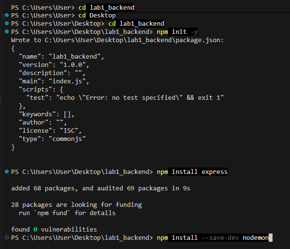
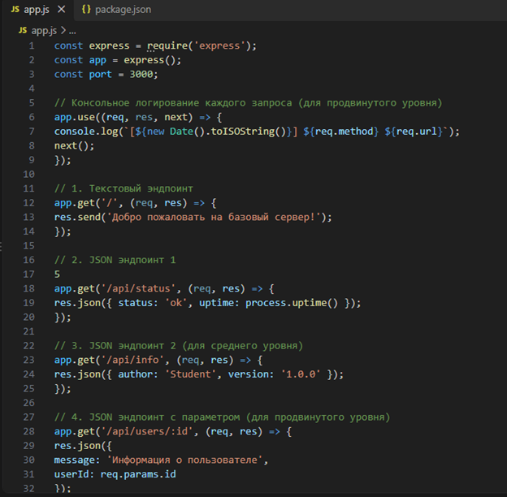
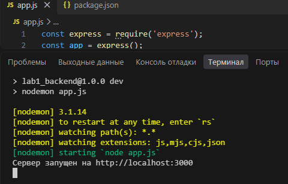
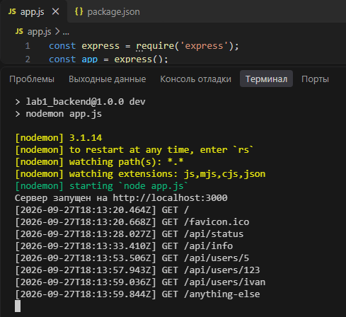
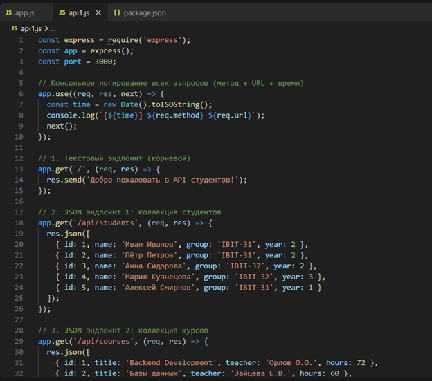
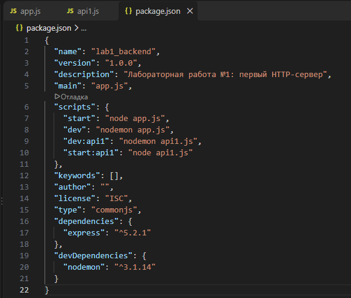
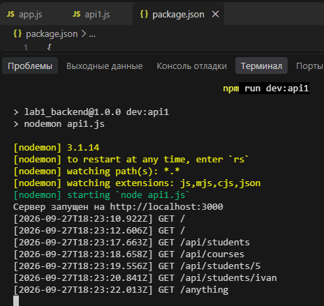

# Лабораторная работа №1. Настройка среды разработки и первый HTTP-сервер

**Студент:** Гуртуев Идар Алиевич

**Группа:** ПИЖ-б-о-25-1

**Вариант:** 7

**Технология:** Node.js + Express

**Репозиторий:** https://github.com/idarr1/Backend-development

## 1. Цель работы

Освоить настройку среды разработки для backend-разработки, создать и запустить минимальный HTTP-сервер, реализовать обработку GET-запросов, работу с эндпоинтами и JSON-ответами, а также настроить автоматический перезапуск сервера при изменении исходного кода.

## 2. Теоретическое обоснование

Backend — серверная часть веб-приложения, которая отвечает за обработку запросов клиентов, выполнение серверной логики и формирование ответов. В клиент-серверной архитектуре клиент отправляет HTTP-запрос серверу, а сервер обрабатывает его и возвращает HTTP-ответ.

Endpoint — конкретный адрес URL вместе с HTTP-методом, по которому клиент обращается к серверу. В данной работе используется метод GET для получения данных. JSON представляет собой текстовый формат обмена структурированными данными.

Node.js позволяет выполнять JavaScript на стороне сервера. Express является веб-фреймворком для Node.js и упрощает создание HTTP-сервера и маршрутов. Для автоматического перезапуска сервера при изменении исходного кода используется Nodemon.

## 3. Выполнение практического примера

### 3.1. Создание проекта

Для выполнения лабораторной работы использовалась среда разработки Visual Studio Code.

Во встроенном терминале были выполнены следующие команды:

```bash
mkdir lab1-backend
cd lab1-backend
npm install express
npm install --save-dev nodemon
```

В результате был создан проект lab1_backend и установлены необходимые зависимости: express и nodemon.



**Рисунок 1 — Создание проекта и установка зависимостей**

### 3.2. Изменение файла `app.js`

В соответствии с методичкой был создан файл `app.js` — базовый пример
HTTP-сервера на Node.js + Express. В него были внесены следующие изменения:

- добавлено **middleware для консольного логирования** всех входящих
  запросов с указанием времени, метода и URL;
- реализован **текстовый эндпоинт** на корневом маршруте `/`;
- реализованы **JSON-эндпоинты** `/api/status` и `/api/info`;
- реализован **параметризованный эндпоинт** `/api/users/:id`;
- добавлен **обработчик 404** с JSON-ответом.



**Рисунок 2 — Файл app.js в редакторе VS Code**

### 3.3. Настройка автоматического перезапуска

Для запуска сервера с помощью Nodemon в файле package.json был добавлен скрипт:

```json
"dev": "nodemon app.js"
```

Для запуска сервера используется команда:

```bash
npm run dev
```

После запуска сервер работает по адресу:

http://localhost:3000



**Рисунок 3 — Запуск сервера с помощью Nodemon**

### 3.4. Запуск проекта с разными эндпоинтами

Последовательно проверил в браузере все эндпоинты, введя в браузерной адресной строке:
1. http://localhost:3000
2. http://localhost:3000/api/status
3. http://localhost:3000/api/info
4. http://localhost:3000/api/users/5
5. http://localhost:3000/api/users/123
6. http://localhost:3000/api/users/ivan
7. http://localhost:3000/anything-else



**Рисунок 4 — Проверка сервера**

## 4. Выполнение индивидуального задания

Для варианта 7 (повышенный уровень) требовалось реализовать:

- 1 текстовый эндпоинт на корневом маршруте `/`;
- 2 простых JSON-эндпоинта — коллекции `/api/students` и `/api/courses`;
- 1 JSON-эндпоинт с параметром в пути — `/api/students/:id`;
- 1 обработчик ошибки 404 с JSON-ответом;
- автоматический перезапуск сервера;
- консольное логирование всех запросов (метод + URL + время).

### 4.1. Реализация сервера

Основной код сервера размещён в файле `api1.js`.

```javascript
const express = require('express');
const app = express();
const port = 3000;

// Консольное логирование всех запросов (метод + URL + время) 
app.use((req, res, next) => {
  const time = new Date().toISOString();
  console.log(`[${time}] ${req.method} ${req.url}`);
  next();
});

// 1. Текстовый эндпоинт (корневой) 
app.get('/', (req, res) => {
  res.send('Добро пожаловать в API студентов!');
});

// 2. JSON эндпоинт 1: коллекция студентов 
app.get('/api/students', (req, res) => {
  res.json([
    { id: 1, name: 'Иван Иванов', group: 'IBIT-31', year: 2 },
    { id: 2, name: 'Пётр Петров', group: 'IBIT-31', year: 2 },
    { id: 3, name: 'Анна Сидорова', group: 'IBIT-32', year: 2 },
    { id: 4, name: 'Мария Кузнецова', group: 'IBIT-32', year: 3 },
    { id: 5, name: 'Алексей Смирнов', group: 'IBIT-31', year: 1 }
  ]);
});

// 3. JSON эндпоинт 2: коллекция курсов 
app.get('/api/courses', (req, res) => {
  res.json([
    { id: 1, title: 'Backend Development', teacher: 'Орлов О.О.', hours: 72 },
    { id: 2, title: 'Базы данных', teacher: 'Зайцева Е.В.', hours: 60 },
    { id: 3, title: 'Web-разработка', teacher: 'Козлов Д.С.', hours: 48 },
    { id: 4, title: 'REST API Design', teacher: 'Орлов О.О.', hours: 36 }
  ]);
});

// 4. JSON эндпоинт с параметром: /api/students/:id 
app.get('/api/students/:id', (req, res) => {
  const studentId = req.params.id;
  res.json({
    requestedId: studentId,
    status: 'success',
    message: `Запрошена информация о студенте с ID = ${studentId}`
  });
});

// 5. Обработка 404 (Not Found)
app.use((req, res) => {
  res.status(404).json({ error: 'Not Found' });
});

// Запуск сервера
app.listen(port, () => {
  console.log(`Сервер запущен на http://localhost:${port}`);
});
```



**Рисунок 5 — Содержание файла api1.js**

### 4.2. Редактирование файла package.json

Для запуска индивидуального задания через Nodemon в package.json были добавлены скрипты:

```json
"scripts": {
  "start": "node app.js",
  "dev": "nodemon app.js",
  "dev:api1": "nodemon api1.js",
  "start:api1": "node api1.js"
}
```

Скрипт dev:api1 запускает файл api1.js через Nodemon - сервер автоматически перезапускается при изменении кода.



**Рисунок 6 — Содержание файла package.json**

### 4.3. Проверка работы сервера

После выполнения лабораторной работы можно проверить работу сервера, открыв браузер и перейдя по адресу `http://localhost:3000`.

Также я открыл другие URL-адреса, чтобы проверить работу других эндпоинтов.

После запуска (npm run dev:api1) были проверены все эндпоинты:

1.	http://localhost:3000/	текст «Добро пожаловать в API студентов!»
2.	http://localhost:3000/api/students	массив из 5 студентов
3.	http://localhost:3000/api/courses	массив из 4 курсов
4.	http://localhost:3000/api/students/5	JSON { requestedId: '5', status: 'success', ... }
5.	http://localhost:3000/api/students/ivan	JSON { requestedId: 'ivan', ... }
6.	http://localhost:3000/anything	JSON { error: 'Not Found' }



**Рисунок 7 — Проверка работы сервера**

## 5. Итоговая структура проекта

После выполнения лабораторной работы структура проекта имеет вид:

```text
lab1_backend/

├── node_modules/

├── screenshots1/

├── api1.js

├── app.js

├── package-lock.json

└── package.json
```

## 6. Ответы на контрольные вопросы

### 1. Что такое клиент-серверная архитектура?

Клиент-серверная архитектура — модель взаимодействия, при которой клиент отправляет запрос серверу, а сервер обрабатывает запрос и возвращает ответ.

### 2. Какой протокол используется для общения клиента и сервера в вебе?

Для общения клиента и сервера используется протокол HTTP.

### 3. Что такое endpoint?

Endpoint — конкретный адрес URL вместе с HTTP-методом, по которому клиент обращается к серверу.

### 4. Что такое JSON?

JSON — текстовый формат обмена структурированными данными, используемый для передачи информации между клиентом и сервером.

### 5. Что такое автоматический перезапуск сервера?

Автоматический перезапуск позволяет серверу самостоятельно перезапускаться после изменения исходного кода. В Node.js для этого используется Nodemon.

### 6. За что отвечает код состояния 404?

Код состояния HTTP 404 означает, что запрошенный маршрут или ресурс не найден.

### 7. Что такое middleware в Express?

Middleware — функция, которая выполняется в процессе обработки HTTP-запроса. В данной работе middleware используется для логирования входящих запросов.

### 8. Как получить параметр из URL-пути?

В Express параметр указывается в маршруте после двоеточия, например /api/students/:id. Его значение можно получить через req.params.id.

## 7. Вывод

В ходе лабораторной работы была настроена среда backend-разработки на Node.js с использованием Express. Был создан и запущен HTTP-сервер, реализованы текстовые и JSON-эндпоинты согласно варианту 7.

Были реализованы маршруты для работы с заказами, статусами, студентами и курсами, а также параметризованный endpoint /api/students/:id. Для неизвестных маршрутов реализована обработка ошибки 404.

С помощью Nodemon настроен автоматический перезапуск сервера при изменении исходного кода. Также реализовано консольное логирование входящих запросов с указанием времени, метода и URL.

В результате были получены практические навыки создания HTTP-сервера на Node.js и Express, работы с GET-запросами, JSON, маршрутами, параметрами URL, обработкой ошибок и middleware.

## 8. Список использованных источников

1. Node.js — официальная документация: https://nodejs.org/en/docs/

2. Express — официальная документация: https://expressjs.com/

3. MDN Web Docs — HTTP: https://developer.mozilla.org/ru/docs/Web/HTTP

4. MDN Web Docs — JSON: https://developer.mozilla.org/ru/docs/Web/JavaScript/Reference/Global_Objects/JSON

5. Nodemon — официальная документация: https://nodemon.io/