# Лабораторная работа №3. Маршрутизация, параметры пути и query-параметры

**Студент:** Гуртуев Идар Алиевич

**Группа:** ПИЖ-б-о-25-1

**Вариант:** 7

**Технология:** Node.js + Express

**Уровень:** Продвинутый

**Репозиторий:** https://github.com/idarr1/Backend-development

---

## 1. Цель работы

Освоить различные способы передачи данных через URL. Научиться строить гибкие маршруты с параметрами пути и query-параметрами, комбинировать их, обрабатывать вложенные ресурсы и валидировать входные данные. Понять разницу между `req.params`, `req.query` и `req.body`.

---

## 2. Теоретическое обоснование

**Маршрутизация (routing)** - механизм сопоставления HTTP-запроса (метод + URL) с кодом-обработчиком на сервере. В Express маршрут описывается как `app.METHOD(PATH, HANDLER)`, где `METHOD` - HTTP-метод, `PATH` - путь URL, `HANDLER` - функция-обработчик с параметрами `req` и `res`.

**Три источника данных в запросе:**

| Источник | Где находится | Express |
|----------|---------------|---------|
| Параметры пути | Часть URL: `/students/42` | `req.params.id` |
| Query-параметры | После `?`: `/students?group=ПИЖ-1` | `req.query.group` |
| Тело запроса | Тело POST/PUT/PATCH | `req.body` |

**Вложенные маршруты (nested routes)** отражают иерархию ресурсов: 
один ресурс принадлежит другому. Пример: `/students/42/grades` - 
оценки студента 42.

**Валидация параметров** - параметры приходят строками, поэтому 
их нужно приводить к нужному типу (`parseInt`) и проверять. 
Невалидный параметр → **400 Bad Request**, отсутствующий ресурс → 
**404 Not Found**.

---

## 3. Выполнение практического примера

### 3.1. Создание проекта

```bash
mkdir lab3_routing_params
cd lab3_routing_params
npm init -y
npm install express
npm install --save-dev nodemon
```

### 3.2. Настройка `package.json`

```json
"scripts": {
  "start": "node app.js",
  "dev": "nodemon app.js"
}
```

### 3.3. Запуск сервера

```bash
npm run dev
```

## 4. Выполнение индивидуального задания

**Вариант 7 (продвинутый уровень). Сущности: Студенты и Курсы.**

**Студенты:** `id`, `name`, `group`, `course`, `avg_grade`.  
**Курсы:** `id`, `title`, `teacher`, `hours`.  
**Статистика:** средний балл.  
**Связь:** по группе.

### 4.1. Реализованные эндпоинты

| № | Метод | URL | Назначение |
|---|-------|-----|------------|
| 1 | GET | `/students` | Все студенты (поиск, сортировка, пагинация) |
| 2 | GET | `/students/stats` | Статистика |
| 3 | GET | `/students/:id` | Один студент |
| 4 | GET | `/students/:id/grades` | Оценки студента (вложенный ресурс) |
| 5 | GET | `/students/:id/related` | Студенты той же группы |
| 6 | GET | `/groups/:group/students` | Студенты группы |
| 7 | GET | `/groups/:group/students/:studentId` | Студент в группе (множественные параметры) |
| 8 | GET | `/courses` | Все курсы |
| 9 | GET | `/courses/:id` | Один курс |
| — | * | `*` | Wildcard → 404 |

### 4.2. Код сервера (`app.js`)

```javascript
const express = require('express');
const fs = require('fs');
const path = require('path');

const app = express();
const port = 3000;

// MIDDLEWARE
app.use(express.json());

const logFile = path.join(__dirname, 'access.log');
app.use((req, res, next) => {
    const time = new Date().toISOString();
    const ip = req.ip || req.socket.remoteAddress;
    const logLine = `[${time}] ${req.method} ${req.url} — ${ip}\n`;
    console.log(logLine.trim());
    fs.appendFile(logFile, logLine, (err) => {
        if (err) console.error('Ошибка записи в лог:', err);
    });
    next();
});

// ХРАНИЛИЩЕ ДАННЫХ
let students = [
    { id: 1, name: 'Иван Иванов', group: 'ПИЖ-1', course: 3, avg_grade: 4.5 },
    { id: 2, name: 'Пётр Петров', group: 'ПИЖ-1', course: 3, avg_grade: 4.2 },
    { id: 3, name: 'Анна Сидорова', group: 'ПИЖ-2', course: 3, avg_grade: 4.8 },
    { id: 4, name: 'Мария Кузнецова', group: 'ПИЖ-2', course: 2, avg_grade: 4.9 },
    { id: 5, name: 'Алексей Смирнов', group: 'ПИЖ-1', course: 2, avg_grade: 3.8 },
    { id: 6, name: 'Ольга Морозова', group: 'ПИЖ-3', course: 3, avg_grade: 4.6 },
    { id: 7, name: 'Дмитрий Волков', group: 'ПИЖ-3', course: 2, avg_grade: 4.0 }
];

let courses = [
    { id: 1, title: 'Backend Development', teacher: 'Орлов О.О.', hours: 72 },
    { id: 2, title: 'Базы данных', teacher: 'Зайцева Е.В.', hours: 60 },
    { id: 3, title: 'Web-разработка', teacher: 'Козлов Д.С.', hours: 48 },
    { id: 4, title: 'REST API Design', teacher: 'Орлов О.О.', hours: 36 },
    { id: 5, title: 'Алгоритмы и структуры данных', teacher: 'Петров А.С.', hours: 90 }
];

let grades = {
    1: [5, 4, 5, 4, 5],
    2: [4, 4, 5, 3, 5],
    3: [5, 5, 5, 4, 5],
    4: [5, 5, 4, 5, 5],
    5: [4, 3, 4, 4, 3],
    6: [5, 4, 5, 5, 4],
    7: [4, 4, 3, 5, 4]
};

function parseId(raw) {
    const id = parseInt(raw);
    return isNaN(id) || id < 1 ? null : id;
}

// ... остальные маршруты (см. файл app.js проекта)
```

> Полный код — в файле `app.js` проекта.

### 4.3. Проверка эндпоинтов

#### 4.3.1. GET все студенты

**Рисунок 1 - GET /students**

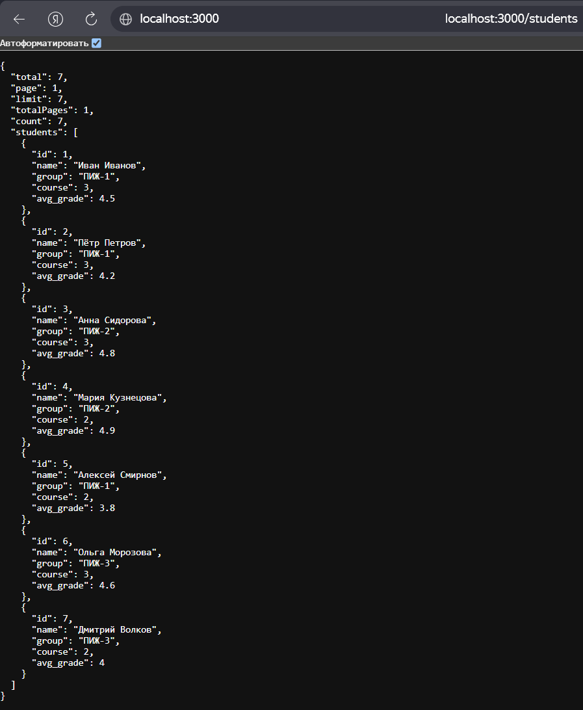

#### 4.3.2. GET статистика

**Рисунок 2 - GET /students/stats**

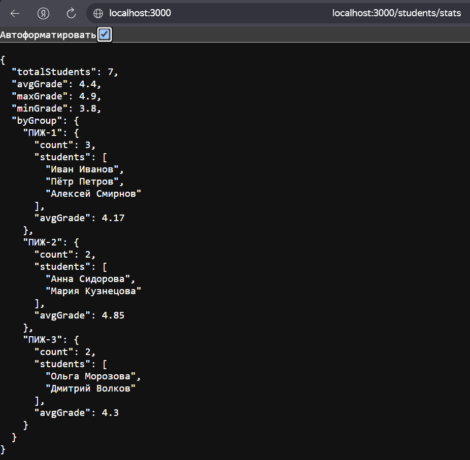

#### 4.3.3. GET один студент

**Рисунок 3 - GET /students/1**

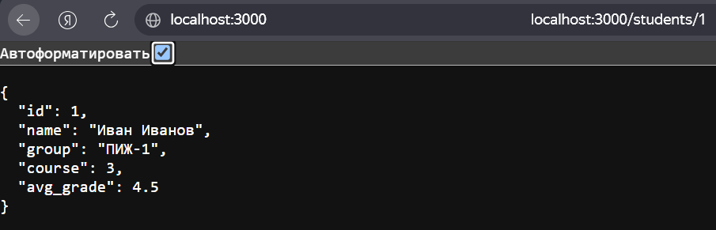

#### 4.3.4. GET оценки студента (вложенный ресурс)

**Рисунок 4 - GET /students/1/grades**

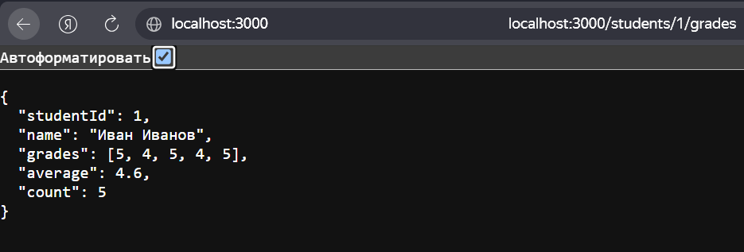

#### 4.3.5. GET связанные студенты

**Рисунок 5 - GET /students/1/related**

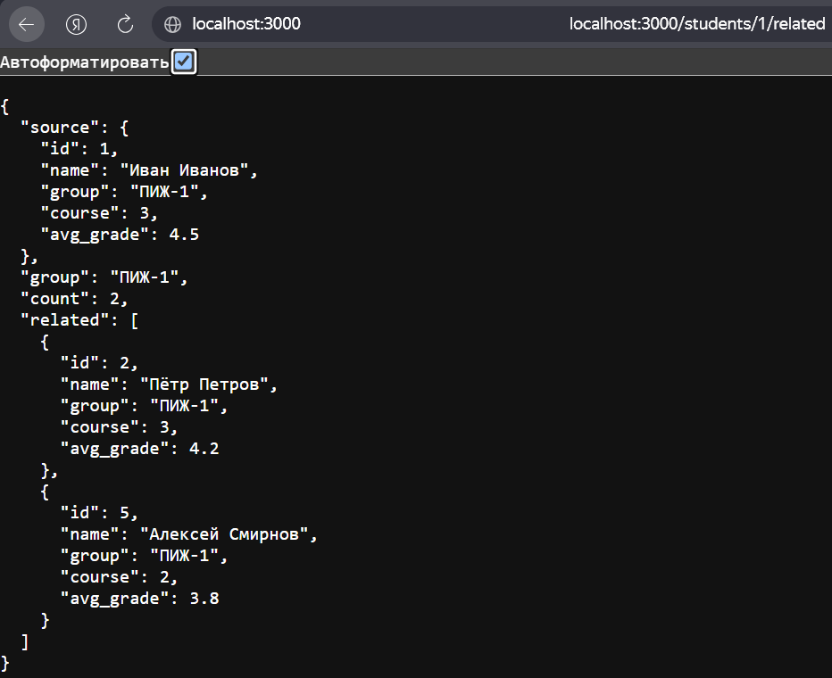

#### 4.3.6. GET студенты группы

**Рисунок 6 - GET /groups/ПИЖ-1/students**

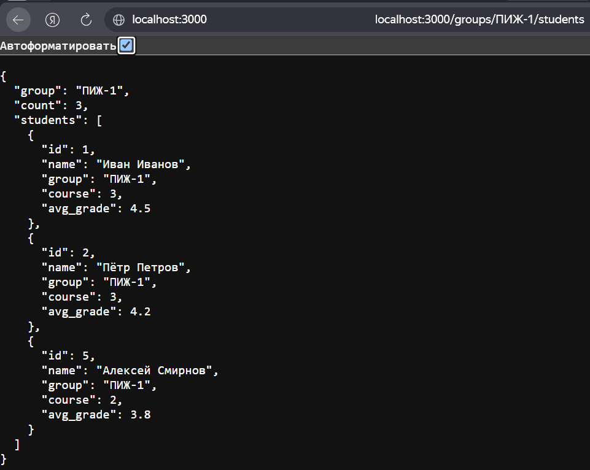

#### 4.3.7. GET студент в группе (множественные параметры)

**Рисунок 7 - GET /groups/ПИЖ-1/students/1**

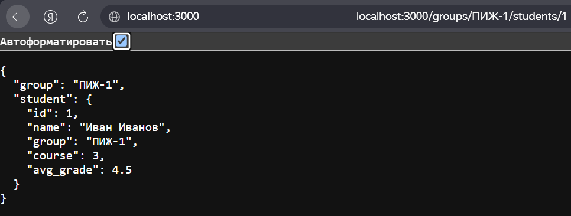

#### 4.3.8. GET все курсы

**Рисунок 8 - GET /courses**

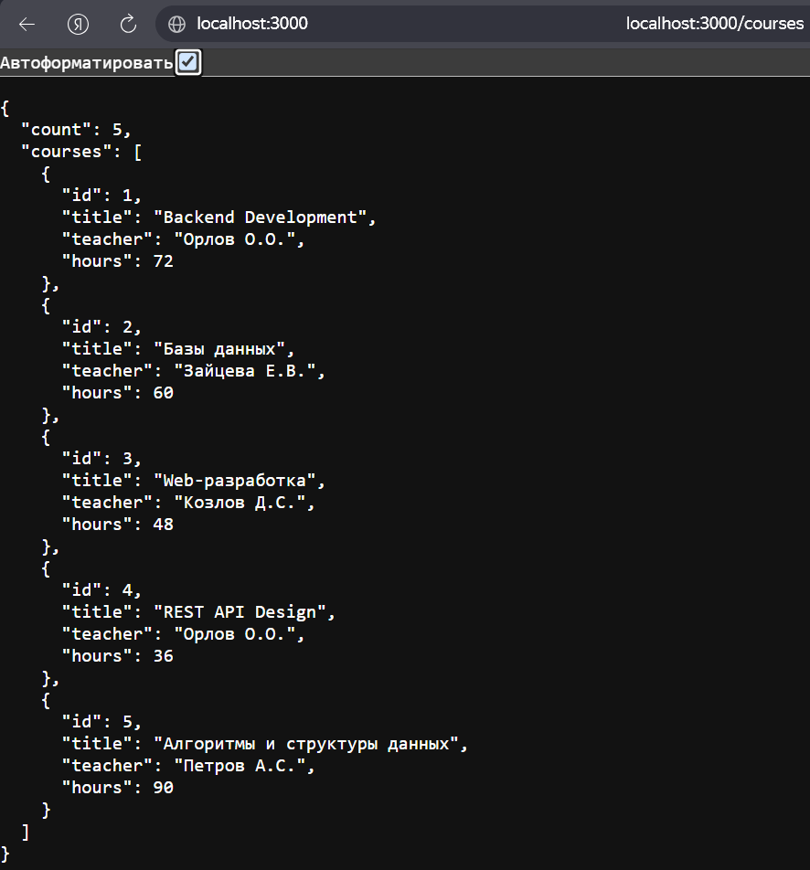

#### 4.3.9. GET один курс

**Рисунок 9 - GET /courses/1**

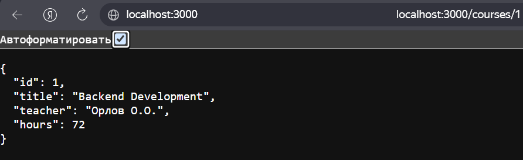

#### 4.3.10. Поиск

**Рисунок 10 - GET /students?search=Анна**

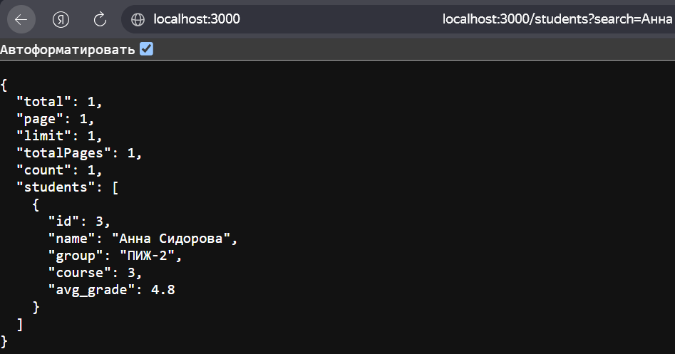

#### 4.3.11. Сортировка

**Рисунок 11 - GET /students?sort=avg_grade&order=desc**

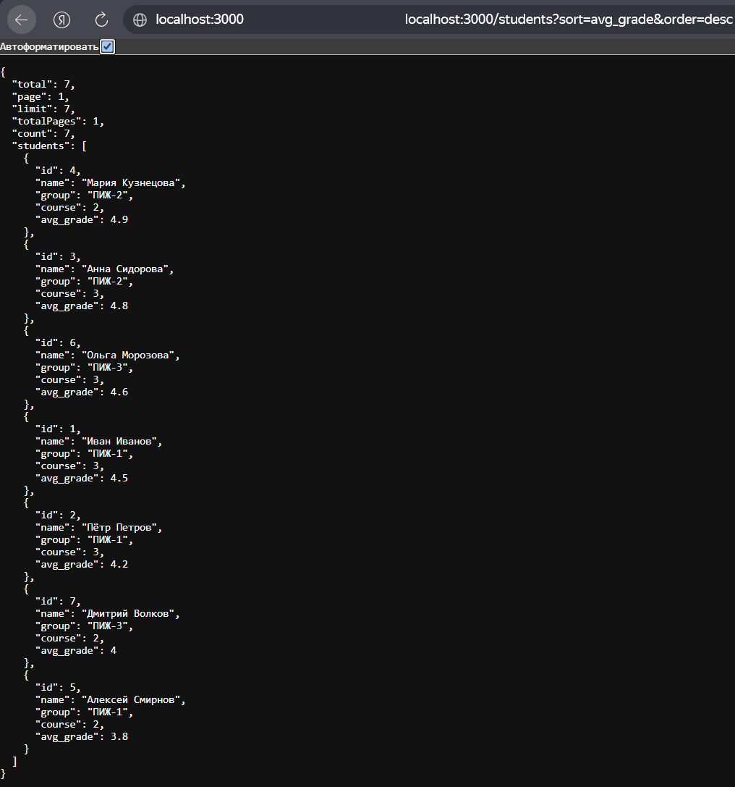

#### 4.3.12. Пагинация

**Рисунок 12 - GET /students?page=1&limit=3**

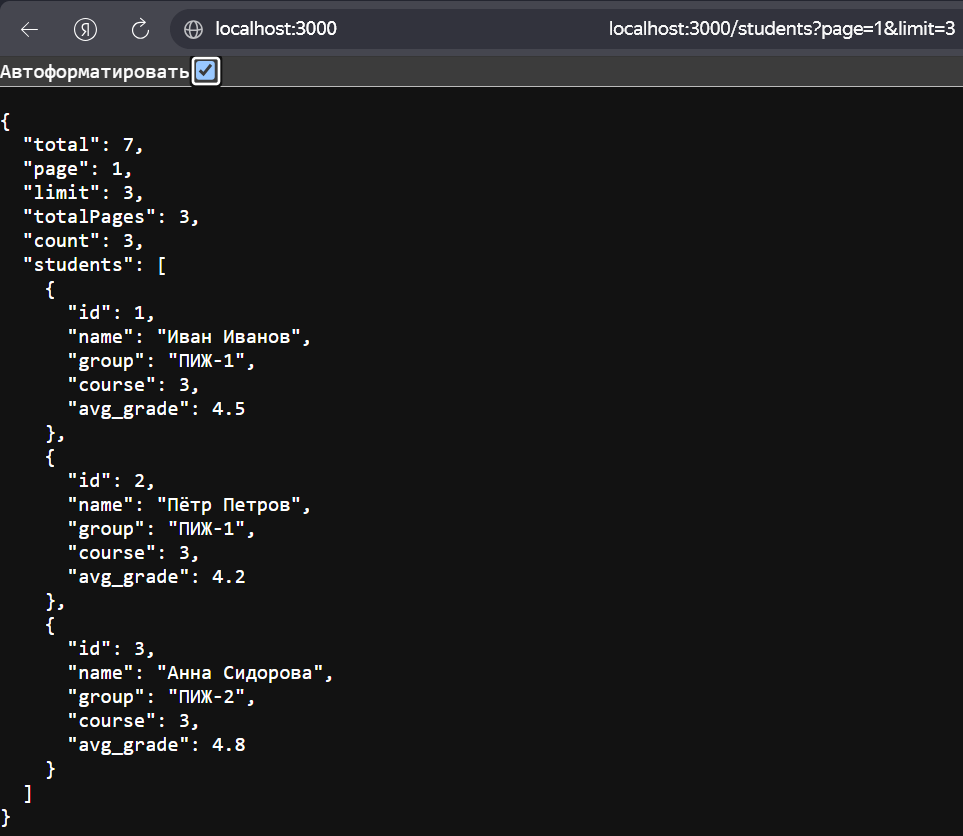

#### 4.3.13. Фильтр по группе

**Рисунок 13 - GET /students?group=ПИЖ-1**

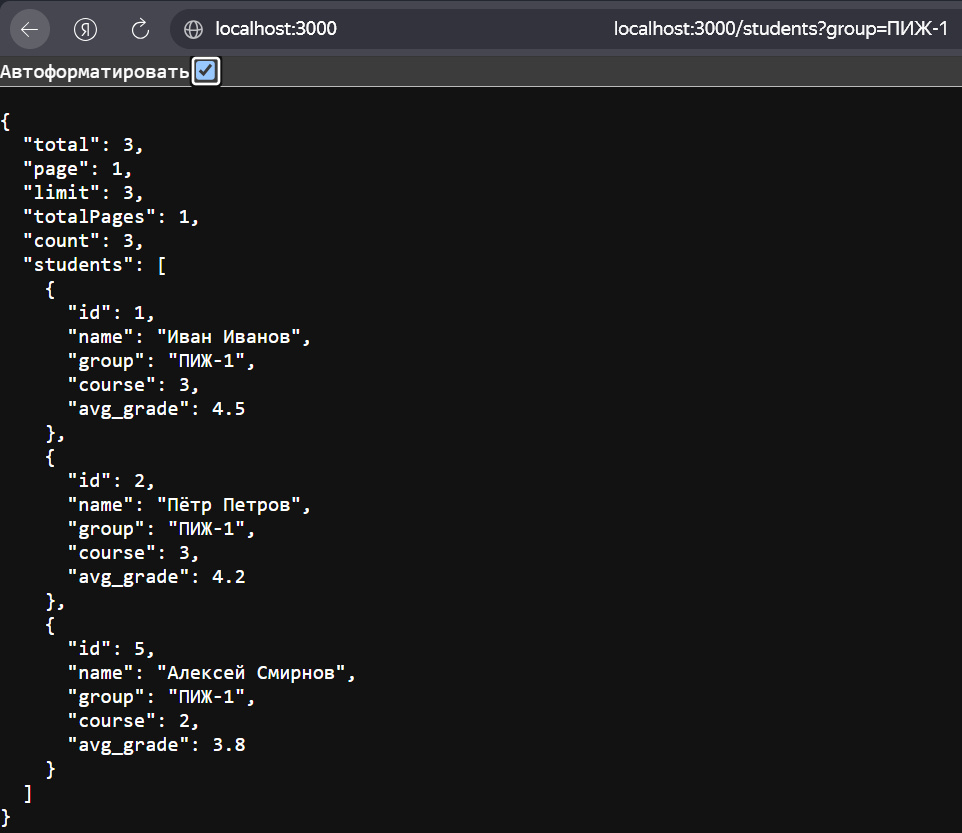

#### 4.3.14. Ошибка 404 - ресурс не найден

**Рисунок 14 - GET /students/999**

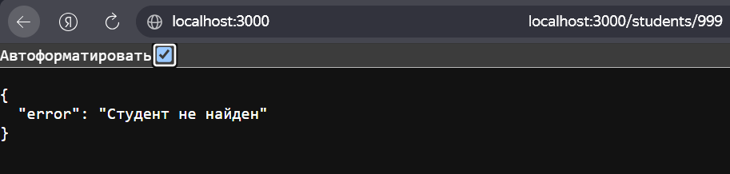

#### 4.3.15. Ошибка 400 - невалидный параметр

**Рисунок 15 - GET /students/abc**

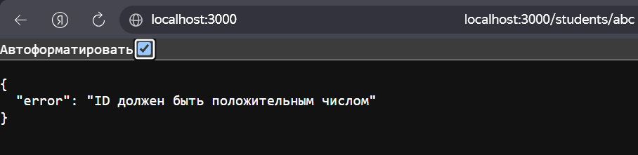

#### 4.3.16. Wildcard 404 - маршрут не найден

**Рисунок 16 - GET /anything**

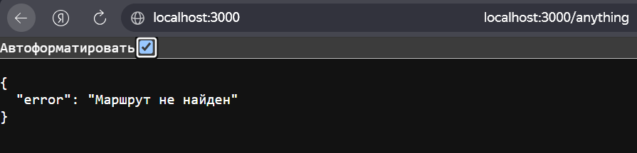

#### 4.3.17. Консольное логирование

**Рисунок 17 - Логи запросов в терминале**

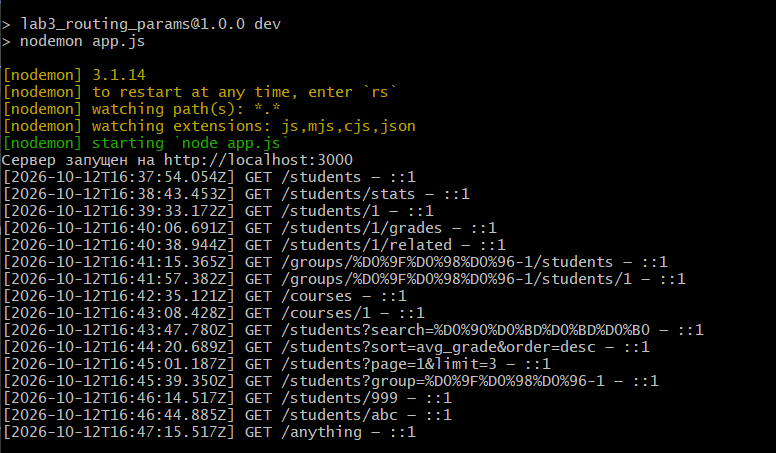

#### 4.3.18. Логирование в файл

**Рисунок 18 - Содержимое access.log**

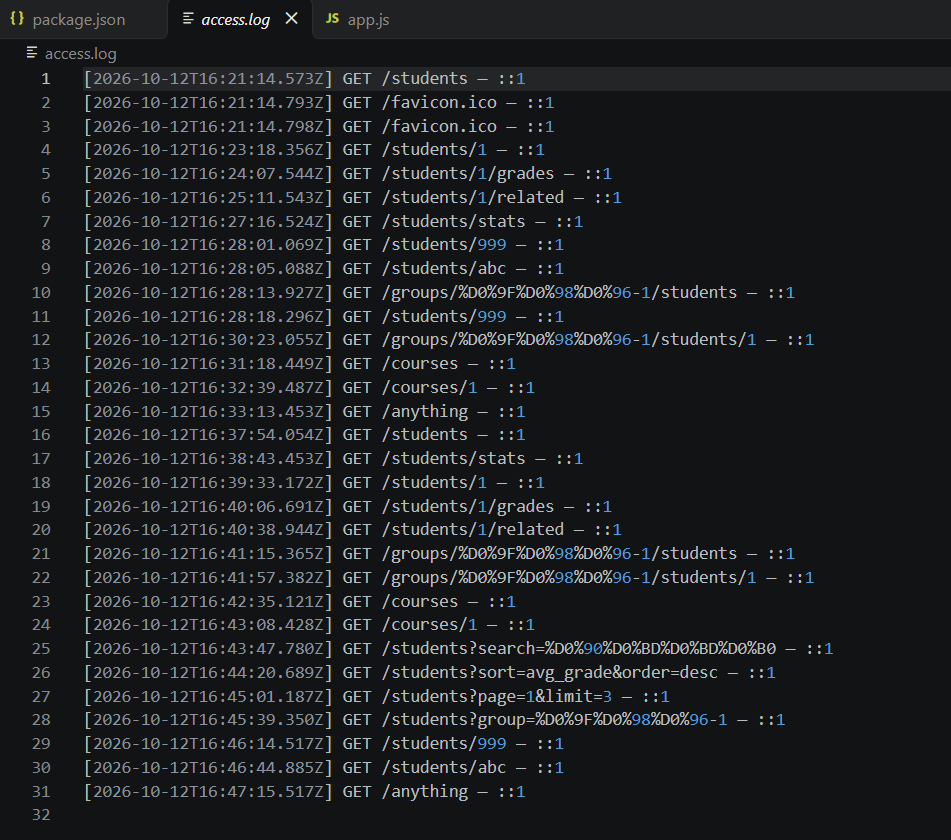

---

## 5. Итоговая структура проекта

```text
lab3_routing_params/
├── node_modules/
├── screenshots3/
│   ├── 01-all-students.png
│   ├── ... (все 18 скринов)
├── access.log
├── app.js
├── package.json
├── package-lock.json
├── .gitignore
└── README.md
```

---

## 6. Ответы на контрольные вопросы

### 1. Что такое маршрутизация? Как она работает в Express?

**Маршрутизация** - механизм сопоставления HTTP-запроса (метод + URL) с кодом-обработчиком. В Express описывается как `app.METHOD(PATH, HANDLER)`. Express перебирает маршруты **в порядке объявления** и вызывает первый, чей метод и путь совпали с запросом.

### 2. Чем отличаются `req.params`, `req.query` и `req.body`?

| Источник | Где | Пример | Когда использовать |
|----------|-----|--------|-------------------|
| `req.params` | В пути URL | `/students/42` → `{ id: '42' }` | Идентификация ресурса |
| `req.query` | После `?` | `/students?group=ПИЖ-1` → `{ group: 'ПИЖ-1' }` | Фильтр, поиск, сортировка |
| `req.body` | В теле запроса | `{ "name": "Иван" }` | Создание/обновление (POST/PUT/PATCH) |

### 3. Как получить параметр пути в Express?

Через `req.params.<имя>`, если маршрут объявлен как `/students/:id`. 
Всегда строка - нужно преобразовывать через `parseInt`.

### 4. Что произойдёт, если не преобразовать параметр пути в число?

Сравнение `city.id === req.params.id` не сработает, потому что `1 !== '1'`. `find` вернёт `undefined`, и вы получите **404**, хотя ресурс существует. Поэтому всегда нужно `parseInt`.

### 5. Как обработать ситуацию, когда параметр пути отсутствует?

Если маршрут `/students/:id`, а запрос `/students` - Express **не вызовет** этот обработчик, а перейдёт к следующему. Если ни один не совпал - сработает wildcard (`app.use(...)`) и вернёт **404**.

### 6. Что такое вложенные маршруты? Приведите пример.

**Вложенный маршрут** - маршрут, где один ресурс логически вложен в другой. 
Пример: `/students/42/grades` — оценки студента 42. В Express:
```javascript
app.get('/students/:id/grades', (req, res) => { ... });
```

### 7. Какой код ответа возвращается, если ресурс не найден?

**404 Not Found**.

### 8. Какой код ответа возвращается при невалидном параметре?

**400 Bad Request**.

### 9. Как объявить необязательный параметр пути в Express?

Через `?` после имени: `/users/:id?` (Express 4.x+). В Express 5 
поддерживается через регулярные выражения или отдельные маршруты.

### 10. Как работает порядок объявления маршрутов в Express? Почему он важен?

Express проверяет маршруты **сверху вниз** и вызывает **первый подходящий**. 
Поэтому:
- **Более специфичные** маршруты (`/students/stats`) - **раньше**
- **Более общие** (`/students/:id`) - **позже**
- **Wildcard** (`app.use(...)`) - **последним**

Иначе `/students/stats` попадёт в `/students/:id` и вернёт 404.

### 11. Как получить query-параметры в Express? Чем они отличаются от параметров пути?

Через `req.query.<имя>`. Отличия:
- **Параметры пути** - часть URL, обязательны, идентифицируют ресурс
- **Query-параметры** - после `?`, опциональны, для фильтрации/поиска

### 12. Как задать значение по умолчанию для query-параметра?

Через логическое ИЛИ:
```javascript
const page = parseInt(req.query.page) || 1;
const limit = parseInt(req.query.limit) || 10;
```

### 13. Как реализовать поиск по подстроке через query-параметр?

```javascript
if (req.query.search) {
    const search = req.query.search.toLowerCase();
    result = result.filter(s => s.name.toLowerCase().includes(search));
}
```

### 14. Как реализовать сортировку по нескольким полям?

Сортировать последовательно: сначала по первому полю, потом по второму (при равенстве первого). Через `Array.sort` с составным компаратором.

### 15. Как реализовать пагинацию с подсчётом общего количества страниц?

```javascript
const page = parseInt(req.query.page) || 1;
const limit = parseInt(req.query.limit) || 10;
const start = (page - 1) * limit;
const paginated = result.slice(start, start + limit);
const totalPages = Math.ceil(result.length / limit);
```

### 16. Как валидировать query-параметры? Какие коды ответов использовать?

Проверять типы (`isNaN`, диапазоны) и допустимые значения. При ошибке - **400 Bad Request** с описанием.

### 17. Как реализовать фильтрацию по нескольким полям одновременно?

Применять `filter` последовательно:
```javascript
if (req.query.group) result = result.filter(s => s.group === req.query.group);
if (req.query.course) result = result.filter(s => s.course === +req.query.course);
```

### 18. Что произойдёт, если query-параметр передан несколько раз?

Express вернёт **массив**: `/students?tag=js&tag=node` → `req.query.tag === ['js', 'node']`.

### 19. Как ограничить максимальное значение `limit`?

```javascript
if (limit > 100) return res.status(400).json({ error: 'limit должен быть от 1 до 100' });
```

### 20. Как использовать белый список полей для сортировки?

```javascript
const allowedSort = ['id', 'name', 'group', 'course', 'avg_grade'];
if (!allowedSort.includes(sort)) {
    return res.status(400).json({ error: 'Недопустимое поле сортировки' });
}
```

### 21. Как комбинировать параметры пути и query-параметры в одном запросе?

Например, `/students/1/grades?sort=desc&limit=3` - путь даёт студента, query - сортировку и пагинацию его оценок. В обработчике: 
`req.params.id` + `req.query.sort` + `req.query.limit`.

### 22. Как реализовать вложенные маршруты с несколькими уровнями?

Например: `/groups/:group/students/:studentId/grades`. 
Все параметры доступны через `req.params`.

### 23. Как обработать wildcard-маршрут и почему он должен быть последним?

```javascript
app.use((req, res) => res.status(404).json({ error: 'Маршрут не найден' }));
```
Должен быть **последним** - иначе перехватит все запросы до того, 
как они дойдут до конкретных маршрутов.

### 24. Как реализовать глобальный обработчик ошибок?

Middleware с 4 аргументами:
```javascript
app.use((err, req, res, next) => {
    res.status(500).json({ error: 'Внутренняя ошибка сервера' });
});
```

### 25. Как логировать все запросы с IP-адресом клиента?

```javascript
const ip = req.ip || req.socket.remoteAddress;
console.log(`[${time}] ${req.method} ${req.url} — ${ip}`);
```

### 26. Как защитить API от слишком больших значений `limit`?

Валидация: `if (limit > 100) return res.status(400)...`. 
Также можно ограничить на уровне middleware или nginx.

### 27. Как реализовать статистику по коллекции?

Отдельный эндпоинт `/students/stats` - агрегация через `reduce`, `Math.max`, `Math.min`, группировка по полям.

### 28. Как организовать структуру проекта при росте числа маршрутов?

Вынести маршруты в отдельные файлы (`routes/students.js`, `routes/courses.js`) и подключать через `app.use('/students', studentsRouter)`.

### 29. Как документировать параметры маршрутов (OpenAPI/Swagger)?

Через OpenAPI-спецификацию (YAML/JSON) и библиотеки вроде `swagger-ui-express`. Или через аннотации в коде и генераторы.

### 30. Как тестировать маршруты с параметрами в Postman?

Создавать отдельные запросы в коллекции, использовать переменные окружения (`{{base_url}}`), писать тесты на вкладке Tests, использовать Collection Runner.

---

## 7. Вывод

В ходе лабораторной работы были освоены различные способы передачи данных через URL в Express. Реализован API для управления коллекциями студентов и курсов с гибкой маршрутизацией.

Реализованы **параметры пути** (`/students/:id`), **вложенные маршруты** (`/students/:id/grades`), **множественные параметры** (`/groups/:group/students/:studentId`), **query-параметры** для поиска, сортировки, пагинации и фильтрации, а также **wildcard-маршрут** для обработки 404.

Настроена **валидация параметров** с возвратом кодов **400 Bad Request** (невалидный ID) и **404 Not Found** (ресурс не найден). Реализовано **консольное логирование** запросов с указанием времени, метода, URL и IP-адреса клиента, а также запись логов в файл `access.log`. Добавлен 
**глобальный обработчик ошибок 500**.

В результате получены навыки проектирования REST-подобных URL, 
комбинирования параметров пути и query-параметров, обработки вложенных ресурсов и валидации входных данных.

---

## 8. Список использованных источников

1. Express - Routing: https://expressjs.com/en/guide/routing.html
2. Express - Request: https://expressjs.com/en/4x/api.html#req
3. HTTP-методы (MDN): https://developer.mozilla.org/ru/docs/Web/HTTP/Methods
4. URL-параметры (MDN): https://developer.mozilla.org/ru/docs/Learn/Common_questions/What_is_a_URL
5. REST API Tutorial: https://restfulapi.net/