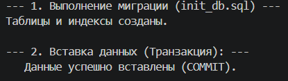
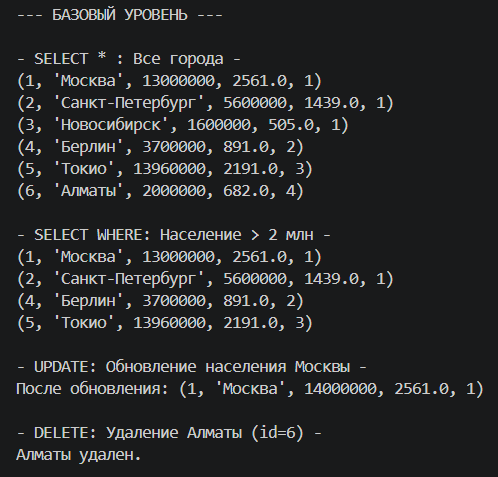
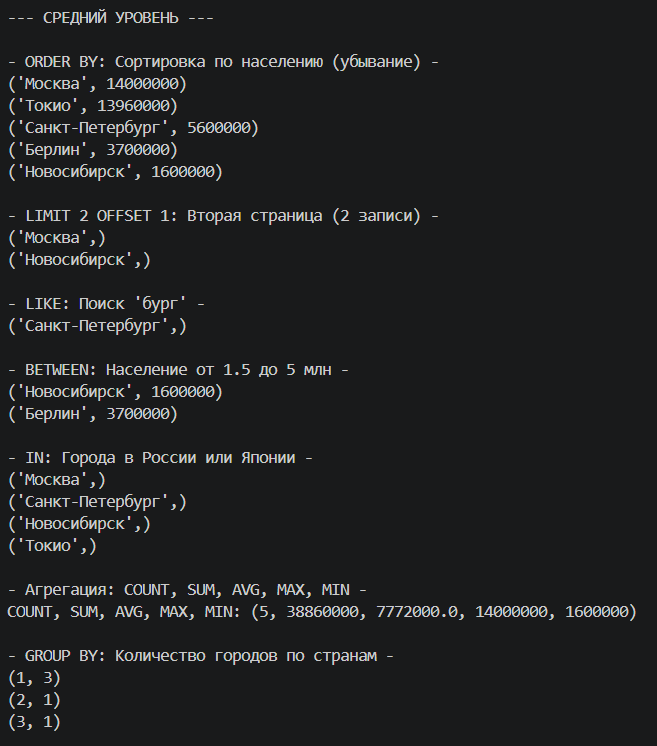
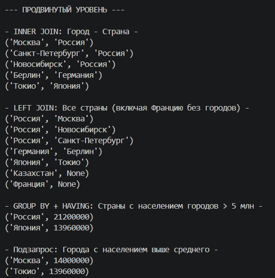

# Лабораторная работа №4. Основы SQL и работа с SQLite

**Студент:** Гуртуев Идар Алиевич

**Группа:** ПИЖ-б-о-25-1

**Вариант:** 7 (Продвинутый уровень)

**Технология:** Python + SQLite

**Репозиторий:** https://github.com/idarr1/Backend-development

---

## 1. Цель работы

Освоить базовые операции SQL. Научиться создавать таблицы, наполнять их данными, выполнять выборку, обновление и удаление записей. Понять разницу между SQL-запросами и работой с данными в памяти. Научиться использовать SQLite в качестве локальной СУБД.

---

## 2. Постановка задачи (Вариант 7)

**Базовый уровень:**
1. Создать БД SQLite с одной таблицей (города).
2. Выполнить INSERT (минимум 5 записей).
3. Выполнить SELECT * (все записи).
4. Выполнить SELECT с WHERE (фильтрация по одному полю).
5. Выполнить UPDATE (обновить одну запись).
6. Выполнить DELETE (удалить одну запись).

**Средний уровень:**
1. SELECT с сортировкой (ORDER BY).
2. SELECT с LIMIT и OFFSET (пагинация, 2 страницы).
3. SELECT с LIKE (поиск по подстроке).
4. SELECT с BETWEEN (диапазон).
5. SELECT с IN (список значений).
6. SELECT с агрегатными функциями (COUNT, AVG, MAX, MIN, SUM).
7. SELECT с GROUP BY (группировка по стране).

**Продвинутый уровень:**
1.  Вторая таблица со связью FOREIGN KEY (один-ко-многим).
2.  INNER JOIN (объединение двух таблиц).
3.  LEFT JOIN (сохранение всех строк из первой таблицы).
4.  GROUP BY + HAVING (группировка с фильтром).
5.  Подзапрос (SELECT внутри SELECT).
6.  Транзакция (BEGIN, COMMIT, ROLLBACK).
7.  Индекс (CREATE INDEX).
8.  Скрипт миграции (отдельный файл init_db.sql).

---

## 3. Ход выполнения работы

### Шаг 1. Подготовка проекта
Создана папка `lab4_sql`. Внутри неё созданы два файла:
- **`init_db.sql`** — скрипт миграции (SQL-код для создания таблиц).
- **`db.py`** — основной скрипт на Python.

### Шаг 2. Написание скрипта миграции (`init_db.sql`)
В файле `init_db.sql` описана структура базы данных:
- Создана таблица **`countries`** (страны) с полями `id` (PRIMARY KEY, AUTOINCREMENT) и `name` (TEXT, UNIQUE).
- Создана таблица **`cities`** (города) с полями `id`, `name`, `population`, `area`, `country_id`. Поле `country_id` объявлено как **FOREIGN KEY**, ссылающееся на `countries.id`, с правилом **ON DELETE CASCADE** (при удалении страны удаляются все её города).
- Создан **индекс** `idx_city_name` по полю `name` в таблице `cities` для ускорения поиска.

### Шаг 3. Написание скрипта на Python (`db.py`)
В скрипте реализованы следующие этапы:

1. **Подключение к БД.** Через `sqlite3.connect('lab4.db')` создаётся или открывается файл базы данных. Включён режим `PRAGMA foreign_keys = ON` для соблюдения связей.
2. **Выполнение миграции.** Скрипт читает файл `init_db.sql` и выполняет его через `cursor.executescript()`. Это создаёт таблицы и индекс.
3. **Очистка БД.** Старый файл `lab4.db` удаляется перед запуском (чтобы ID всегда начинались с 1), затем таблицы очищаются.
4. **Вставка данных в транзакции.** Используется `BEGIN ... COMMIT`. Вставляются 4 страны (с явным указанием ID) и 6 городов, привязанных к странам. Если возникает ошибка — выполняется `ROLLBACK`.
5. **Базовый уровень.** Выполнены 4 запроса: `SELECT *`, `SELECT WHERE population > 2000000`, `UPDATE` (население Москвы), `DELETE` (Алматы).
6. **Средний уровень.** Выполнены 7 запросов: `ORDER BY DESC`, `LIMIT 2 OFFSET 1`, `LIKE '%бург%'`, `BETWEEN 1500000 AND 5000000`, `IN (1, 3)`, агрегация (`COUNT, SUM, AVG, MAX, MIN`), `GROUP BY country_id`.
7. **Продвинутый уровень.** Выполнены 4 запроса: `INNER JOIN` (города + страны), `LEFT JOIN` (все страны, включая Францию), `GROUP BY + HAVING` (страны с населением > 5 млн), подзапрос (города с населением выше среднего).
8. **Закрытие соединения.** `conn.close()`.

### Шаг 4. Запуск и проверка
Скрипт запущен командой `python db.py`. Вывод разделён на 3 блока (базовый, средний, продвинутый) для удобства скриншотов.

---

## 4. Структура БД

**Таблица `countries` (Страны):**
- `id` — уникальный ID (PRIMARY KEY).
- `name` — название страны (UNIQUE).

**Таблица `cities` (Города):**
- `id` — уникальный ID.
- `name` — название города.
- `population` — население.
- `area` — площадь.
- `country_id` — внешний ключ на `countries.id` (FOREIGN KEY, ON DELETE CASCADE).

**Связь:** один-ко-многим (одна страна — много городов).

---

## 5. Файлы проекта

- **`init_db.sql`** — скрипт миграции (создание таблиц, связей, индекса).
- **`db.py`** — основной скрипт на Python (подключение, вставка, запросы).

---

## 6. Результаты работы

**Рисунок 1 — Миграция и вставка данных**

**Рисунок 2 — Базовый уровень (SELECT, WHERE, UPDATE, DELETE)**

**Рисунок 3 — Средний уровень (ORDER BY, LIMIT, LIKE, BETWEEN, IN, агрегация, GROUP BY)**

**Рисунок 4 — Продвинутый уровень (JOIN, HAVING, подзапрос)**

---

## 7. Анализ результатов

### Базовый уровень
- Все города содержат корректные данные (ID, название, население, площадь, ID страны).
- `UPDATE` успешно изменил население Москвы на 14 млн.
- `DELETE` удалил Алматы (ID 6).

### Средний уровень
- `ORDER BY DESC` показывает города от самого населённого к наименее.
- `LIMIT 2 OFFSET 1` — вторая страница (пропущен 1 город, взяты 2).
- `LIKE '%бург%'` нашёл Санкт-Петербург (содержит «бург»).
- `BETWEEN 1500000 AND 5000000` — 2 города в диапазоне.
- `IN (1, 3)` — 4 города в России и Японии.
- Агрегация: 5 городов, общее население 38.86 млн, среднее 7.77 млн.
- `GROUP BY` — 3 города в России, по 1 в Германии и Японии.

### Продвинутый уровень
- `INNER JOIN` — 5 городов с их странами.
- `LEFT JOIN` — все страны, включая Казахстан и Францию (у них города `None`).
- `GROUP BY + HAVING` — Россия (21.2 млн) и Япония (13.96 млн) превысили 5 млн.
- Подзапрос — Москва и Токио (население выше среднего 7.77 млн).

---

## 8. Ответы на контрольные вопросы

### 1. Что такое SQL?
Язык структурированных запросов для работы с реляционными базами данных. Декларативный: описываем, **что** хотим, а СУБД решает, **как** это сделать.

### 2. Что такое SQLite? В чём его особенность?
Встроенная реляционная СУБД. Хранит всю базу в одном файле. Не требует сервера. Идеальна для обучения и прототипов.

### 3. Что такое первичный ключ (PRIMARY KEY)?
Уникальный идентификатор записи в таблице. Не может быть NULL и не может повторяться.

### 4. Что такое внешний ключ (FOREIGN KEY)?
Поле, которое ссылается на первичный ключ другой таблицы. Обеспечивает целостность связей.

### 5. Что делает `ON DELETE CASCADE`?
При удалении родительской записи (страны) автоматически удаляются все зависимые (города).

### 6. В чём разница между INNER JOIN и LEFT JOIN?
`INNER JOIN` возвращает только строки, где есть совпадения в обеих таблицах. `LEFT JOIN` возвращает все строки из левой таблицы, даже если в правой нет совпадений (тогда `NULL`).

### 7. Что такое GROUP BY?
Группировка строк по одному или нескольким полям для применения агрегатных функций.

### 8. Чем HAVING отличается от WHERE?
`WHERE` фильтрует строки **до** группировки. `HAVING` фильтрует **после** группировки (по результатам агрегации).

### 9. Что такое подзапрос?
Запрос внутри другого запроса. Например, `SELECT ... WHERE x > (SELECT AVG(x) FROM ...)`.

### 10. Что такое транзакция?
Набор операций, выполняемых как единое целое. Либо все выполняются (COMMIT), либо ни одна (ROLLBACK).

### 11. Что такое индекс? Зачем он нужен?
Структура для ускорения поиска по колонке (как алфавитный указатель). Ускоряет SELECT, но замедляет INSERT и UPDATE.

### 12. Почему в SQLite не нужен отдельный сервер?
Это встроенная БД, которая работает как библиотека внутри программы. Файл `.db` хранит всё.

### 13. Как подключить SQLite к Python?
Через встроенный модуль `sqlite3`: `conn = sqlite3.connect('file.db')`.

### 14. Чем `fetchone()` отличается от `fetchall()`?
`fetchone()` — одна строка (кортеж). `fetchall()` — все строки (список кортежей).

### 15. Что такое параметризованный запрос?
Запрос с `?` вместо значений, которые передаются отдельно. Защищает от SQL-инъекций.

---

## 9. Вывод

В ходе лабораторной работы освоены базовые и продвинутые операции SQL в SQLite. Созданы две таблицы со связью FOREIGN KEY, реализованы все CRUD-операции, фильтрация, сортировка, пагинация, агрегация, группировка, подзапросы, JOIN'ы и транзакции.

Изучена разница между работой с данными в памяти (ЛР №2–3) и с реальной базой данных: БД обеспечивает целостность (FOREIGN KEY), транзакции, индексы для ускорения. Получены навыки подключения SQLite к Python.

---

## 10. Список использованных источников

1. Документация SQLite: https://www.sqlite.org/docs.html
2. Документация Python sqlite3: https://docs.python.org/3/library/sqlite3.html
3. SQL Tutorial (W3Schools): https://www.w3schools.com/sql/