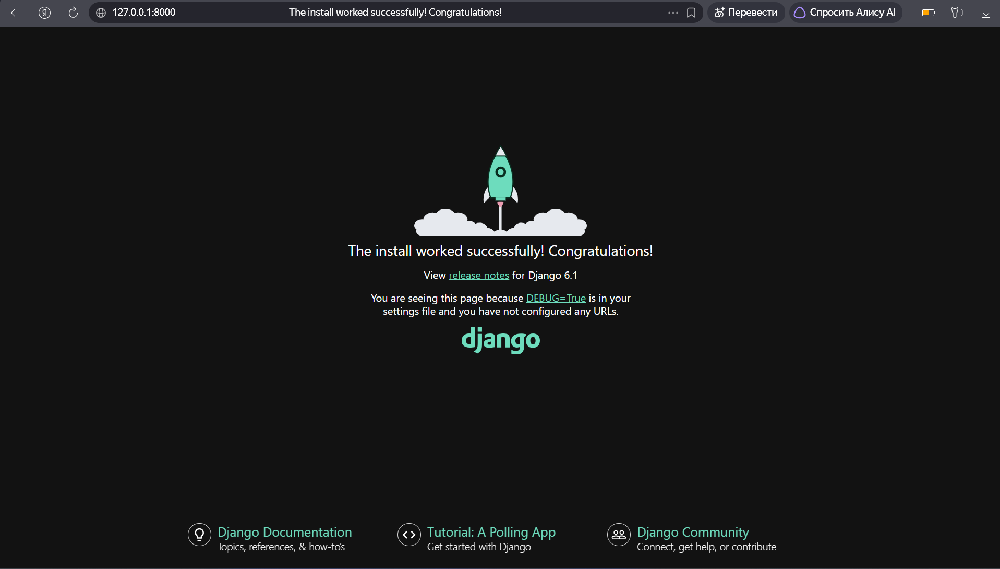
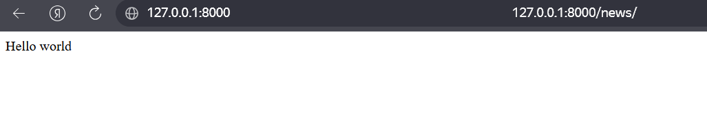
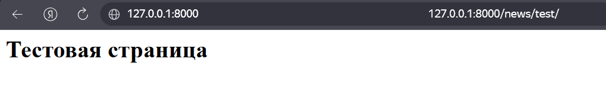
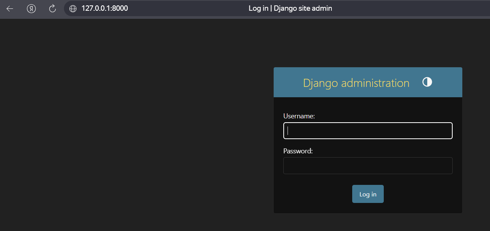

# Лабораторная работа №1. Создание виртуального окружения. Контроллеры и маршруты

**Студент:** Гуртуев Идар Алиевич

**Группа:** ПИЖ-б-о-25-1

**Технология:** Python + Django

**Репозиторий:** https://github.com/idarr1/Backend-and-web-application-development

---

## 1. Цель работы

Настроить виртуальное пространство. Разработать контроллер приложения и организовать маршруты.

---

## 2. Теоретическое обоснование

**Виртуальное окружение (venv)** — изолированная среда Python, в которой устанавливаются библиотеки только для конкретного проекта. Это нужно, чтобы разные проекты не конфликтовали по версиям библиотек.

**Django** — это популярный веб-фреймворк на Python, который позволяет быстро создавать веб-приложения. Работает по модели MTV (Model-Template-View), где:
- **Model** — работа с базой данных;
- **Template** — HTML-шаблоны;
- **View** — логика обработки запросов (контроллеры).

**Контроллер (View в Django)** — функция Python, которая принимает HTTP-запрос (`request`) и возвращает HTTP-ответ (`HttpResponse`).

**Маршрутизация (URLconf)** — механизм сопоставления URL-адресов с функциями-контроллерами. В Django маршруты описываются в файлах `urls.py` с помощью функции `path()`.

---

## 3. Выполнение практического примера

### 3.1. Создание проекта и виртуального окружения

При создании проекта PyCharm автоматически создал виртуальное окружение `.venv` в папке проекта.

**Рисунок 1 — Успешная установка Django (ракета)**



### 3.2. Установка Django

В терминале PyCharm (с активированным `.venv`) выполнена команда:

```bash
pip install django
```

Проверка:

```bash
python -m django --version
```

Результат: **Django 6.1.2**.

### 3.3. Создание проекта и приложения

```bash
django-admin startproject MySite
cd MySite
python manage.py startapp news
```

### 3.4. Регистрация приложения

В файле `MySite/settings.py` добавлена строка в `INSTALLED_APPS`:

```python
INSTALLED_APPS = [
    'django.contrib.admin',
    'django.contrib.auth',
    'django.contrib.contenttypes',
    'django.contrib.sessions',
    'django.contrib.messages',
    'django.contrib.staticfiles',
    'news.apps.NewsConfig',
]
```

### 3.5. Создание контроллеров

В файле `news/views.py`:

```python
from django.http import HttpResponse

def index(request):
    print(request)
    return HttpResponse('Hello world')

def test(request):
    return HttpResponse('<h1>Тестовая страница</h1>')
```

### 3.6. Настройка маршрутов

**Файл `news/urls.py` (создан вручную):**

```python
from django.urls import path
from .views import index, test

urlpatterns = [
    path('', index, name='index'),
    path('test/', test, name='test'),
]
```

**Файл `MySite/urls.py`:**

```python
from django.contrib import admin
from django.urls import path, include

urlpatterns = [
    path('admin/', admin.site.urls),
    path('news/', include('news.urls')),
]
```

---

## 4. Проверка работы

### 4.1. Главная страница приложения `news`

URL: http://127.0.0.1:8000/news/

**Рисунок 2 — Контроллер `index` (Hello world)**



### 4.2. Тестовая страница

URL: http://127.0.0.1:8000/news/test/

**Рисунок 3 — Контроллер `test`**



### 4.3. Админка Django

URL: http://127.0.0.1:8000/admin/

**Рисунок 4 — Страница входа в админку**



---

## 5. Итоговая структура проекта

```text
lab1/
├── .venv/                    # виртуальное окружение
├── screenshots/              # скриншоты
├── main.py                   # welcome script (не используется)
├── MySite/                   # Django-проект
│   ├── MySite/               # пакет конфигурации
│   │   ├── settings.py
│   │   ├── urls.py
│   │   └── ...
│   ├── news/                 # приложение
│   │   ├── views.py
│   │   ├── urls.py
│   │   ├── models.py
│   │   ├── admin.py
│   │   └── ...
│   ├── db.sqlite3
│   └── manage.py
└── README.md
```

## 6. Вывод

В ходе лабораторной работы было настроено виртуальное окружение Python, установлен фреймворк Django (версия 6.1.2), создан Django-проект `MySite` и приложение `news`.

Освоены ключевые концепции Django: контроллеры (views), маршрутизация (urls), регистрация приложений в `settings.py`. Реализованы два контроллера — `index` (выводит `Hello world`) и `test` (выводит HTML-заголовок). Настроены маршруты так, чтобы `/news/` вызывал `index`, а `/news/test/` — `test`.

Проверена работа админки Django на `/admin/`. Сервер запускается командой `python manage.py runserver` и работает на `http://127.0.0.1:8000/`.

В результате получены практические навыки работы с PyCharm, виртуальным окружением и основами веб-разработки на Django.

---

## 7. Список использованных источников

1. Django — официальная документация: https://docs.djangoproject.com/
2. Django — Routing (URL dispatcher): https://docs.djangoproject.com/en/stable/topics/http/urls/
3. Django — Views: https://docs.djangoproject.com/en/stable/topics/http/views/
4. Python — venv: https://docs.python.org/3/library/venv.html
5. PyCharm — документация: https://www.jetbrains.com/help/pycharm/