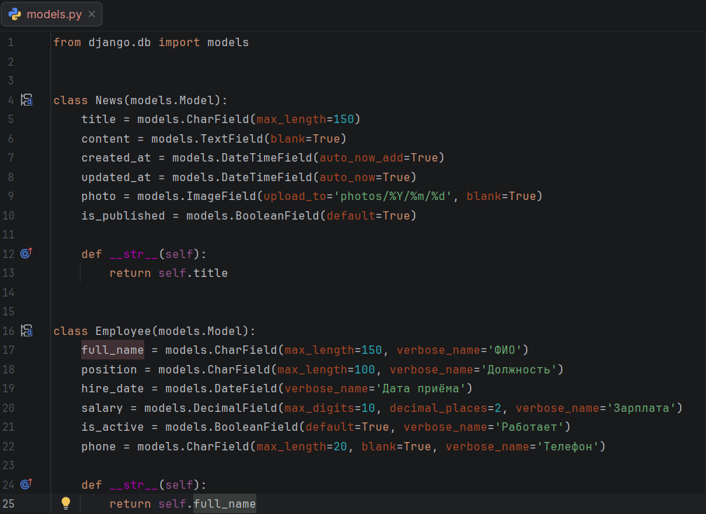
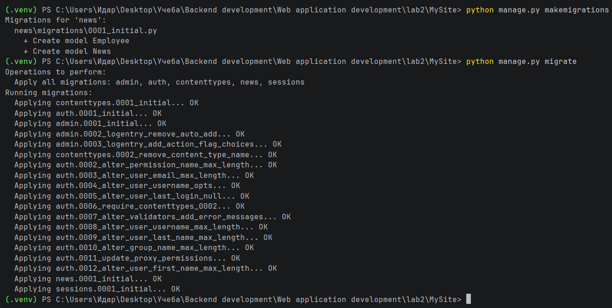
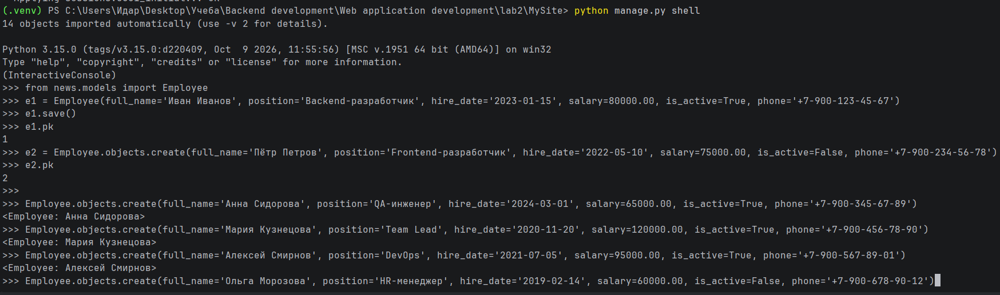
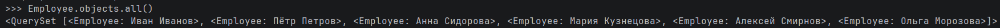
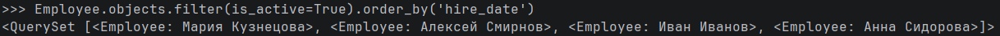
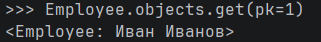
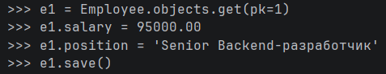
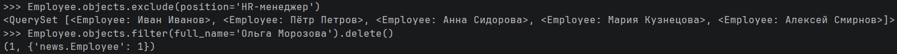

# Лабораторная работа №2. Модели в Django и работа с ORM

**Студент:** Гуртуев Идар Алиевич

**Группа:** ПИЖ-б-о-25-1

**Вариант:** 7 (Сотрудники — Employee)

**Технология:** Python + Django

**Репозиторий:** https://github.com/idarr1/Backend-development

---

## 1. Цель работы

Изучить работу с моделями в Django, освоить миграции и взаимодействие с базой данных через ORM (Object-Relational Mapping).

---

## 2. Теоретическое обоснование

**Модель (Model)** — это слой данных в архитектуре MTV (Model-Template-View). Каждая модель в Django наследуется от `django.db.models.Model` и соответствует одной таблице в базе данных.

**Поля модели** — это экземпляры классов `Field`. Основные типы:
- `CharField` — строка (обязателен `max_length`);
- `TextField` — текст большого объёма;
- `DateField` / `DateTimeField` — дата / дата-время;
- `DecimalField` — число с плавающей точкой (для денег);
- `BooleanField` — логическое поле (True/False).

**Миграции** — это способ Django отслеживать изменения в моделях и применять их к структуре БД. Команды:
- `python manage.py makemigrations` — создать файлы миграций;
- `python manage.py migrate` — применить миграции к БД.

**ORM (Object-Relational Mapping)** — позволяет работать с базой данных через Python-код, без написания SQL. Основные методы:
- **Create:** `News.objects.create(...)` или `obj = News(...); obj.save()`;
- **Read:** `.all()`, `.filter()`, `.get()`, `.exclude()`;
- **Update:** изменить атрибуты и вызвать `.save()`;
- **Delete:** вызвать `.delete()` у объекта.

---

## 3. Выполнение практического примера

### 3.1. Создание модели

В файле `news/models.py` описана модель `Employee`:

```python
class Employee(models.Model):
    full_name = models.CharField(max_length=150, verbose_name='ФИО')
    position = models.CharField(max_length=100, verbose_name='Должность')
    hire_date = models.DateField(verbose_name='Дата приёма')
    salary = models.DecimalField(max_digits=10, decimal_places=2, verbose_name='Зарплата')
    is_active = models.BooleanField(default=True, verbose_name='Работает')
    phone = models.CharField(max_length=20, blank=True, verbose_name='Телефон')

    def __str__(self):
        return self.full_name
```

**Рисунок 1 — Модель Employee в models.py**



### 3.2. Миграции

Создание и применение миграций:

```bash
python manage.py makemigrations
python manage.py migrate
```

**Рисунок 2 — Выполнение миграций**



### 3.3. Заполнение базы данных

Данные добавлены через консоль Django (`python manage.py shell`) с использованием метода `objects.create()`.

**Рисунок 3 — Создание сотрудников через shell**



---

## 4. Выполнение индивидуального задания (Вариант 7)

### 4.1. Чтение всех записей

```python
Employee.objects.all()
```

**Рисунок 4 — Получение всех сотрудников**



### 4.2. Фильтрация и сортировка

По заданию требовалось вывести всех активных сотрудников, отсортированных по дате приёма:

```python
Employee.objects.filter(is_active=True).order_by('hire_date')
```

**Рисунок 5 — Активные сотрудники по дате приёма**



### 4.3. Получение одной записи

```python
Employee.objects.get(pk=1)
```

**Рисунок 6 — Получение сотрудника по ID**



### 4.4. Обновление записи

```python
e1 = Employee.objects.get(pk=1)
e1.salary = 95000.00
e1.position = 'Senior Backend-разработчик'
e1.save()
```

**Рисунок 7 — Обновление записи**



### 4.5. Удаление записи

```python
Employee.objects.filter(full_name='Ольга Морозова').delete()
```

**Рисунок 8 — Удаление записи**



---

## 5. Настройка медиафайлов

В файле `settings.py` добавлены константы для загрузки файлов:

```python
MEDIA_URL = '/media/'
MEDIA_ROOT = BASE_DIR / 'media'
```

В корневом `urls.py` добавлен маршрут для обслуживания медиафайлов в режиме DEBUG:

```python
if settings.DEBUG:
    urlpatterns += static(settings.MEDIA_URL, document_root=settings.MEDIA_ROOT)
```

---

## 6. Итоговая структура проекта

```text
lab2/
├── .venv/
├── MySite/
│   ├── MySite/
│   │   ├── settings.py
│   │   ├── urls.py
│   │   └── ...
│   ├── news/
│   │   ├── migrations/
│   │   │   ├── 0001_initial.py
│   │   │   └── __init__.py
│   │   ├── models.py
│   │   └── ...
│   ├── media/
│   ├── db.sqlite3
│   └── manage.py
├── screenshots/
│   ├── 01-models.png
│   ├── ... (все 8 скринов)
├── .gitignore
└── README.md
```

---

## 7. Ответы на контрольные вопросы

### 1. Что такое модель в Django и для чего она используется?

Модель — это Python-класс, описывающий структуру таблицы в БД. Наследуется от `models.Model`. Используется для работы с данными через ORM: создание, чтение, обновление, удаление записей.

### 2. Какие типы полей вы знаете? Приведите примеры.

- `CharField(max_length=150)` — строка;
- `TextField()` — длинный текст;
- `DateField()` / `DateTimeField()` — дата / дата-время;
- `DecimalField()` — число с точкой (для денег);
- `BooleanField()` — True/False;
- `ImageField(upload_to=...)` — изображение.

### 3. Чем отличаются параметры `blank=True` и `null=True`?

- `blank=True` — поле может быть пустым **в формах** (валидация на уровне Django);
- `null=True` — в базе данных может храниться **NULL** (отсутствие значения).
Часто используют вместе, если поле необязательное.

### 4. Что такое миграции и зачем они нужны?

Миграции — это файлы, которые Django генерирует на основе изменений в моделях. Они позволяют применить эти изменения к структуре БД без ручного SQL. Команды: `makemigrations` (создать) и `migrate` (применить).

### 5. Как создать суперпользователя для доступа к административной панели Django?

```bash
python manage.py createsuperuser
```
Затем ввести логин, email и пароль. После этого можно войти в `/admin/`.

### 6. Что такое ORM? Перечислите основные методы для CRUD.

ORM — Object-Relational Mapping, работа с БД через Python-объекты вместо SQL.
- Create: `objects.create()`, `obj.save()`;
- Read: `all()`, `filter()`, `get()`, `exclude()`;
- Update: изменить атрибуты + `save()`;
- Delete: `obj.delete()`.

### 7. В чём разница между `filter()` и `get()`?

- `filter()` возвращает `QuerySet` (может быть 0, 1 или много записей);
- `get()` возвращает **ровно один** объект. Если записей нет или их больше одной — возникает исключение (`DoesNotExist` или `MultipleObjectsReturned`).

### 8. Как настроить загрузку изображений (медиафайлов)?

В `settings.py`: `MEDIA_URL = '/media/'`, `MEDIA_ROOT = BASE_DIR / 'media'`.
В корневом `urls.py` — маршрут через `static()` в режиме DEBUG.

### 9. Для чего нужен метод `__str__` в модели?

Возвращает строковое представление объекта. Используется в админке, консоли и при выводе `QuerySet` — вместо `<Employee: Employee object (1)>` показывает `<Employee: Иван Иванов>`.

### 10. Что произойдёт, если выполнить `makemigrations`, но не выполнить `migrate`?

Файл миграции создастся, но изменения **не применятся** к базе данных. Таблица не появится, данные не сохранятся. Нужно обязательно выполнить `migrate`.

---

## 8. Вывод

В ходе лабораторной работы были изучены модели Django и ORM. Создана модель `Employee` с полями `full_name`, `position`, `hire_date`, `salary`, `is_active`, `phone`. Выполнены миграции, создана таблица в базе данных SQLite.

Через консоль Django (`shell`) освоены все CRUD-операции: создание 6 сотрудников разными способами, чтение всех записей, фильтрация по условию (`is_active=True`) с сортировкой (`order_by('hire_date')`), получение одной записи (`get()`), обновление (`save()`) и удаление (`delete()`).

В результате получены практические навыки работы с ORM Django, миграциями и консолью shell.

---

## 9. Список использованных источников

1. Django — Models: https://docs.djangoproject.com/en/stable/topics/db/models/
2. Django — Migrations: https://docs.djangoproject.com/en/stable/topics/migrations/
3. Django — QuerySet API: https://docs.djangoproject.com/en/stable/ref/models/querysets/
4. Django — Managing media files: https://docs.djangoproject.com/en/stable/topics/files/
5. Django — Shell: https://docs.djangoproject.com/en/stable/ref/django-admin/#shell