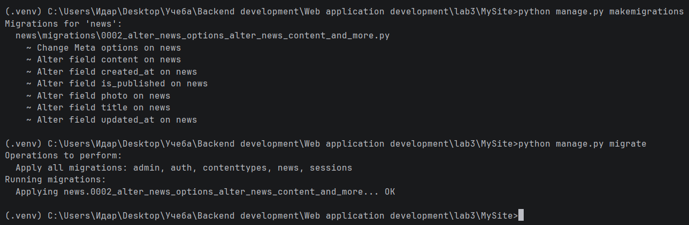
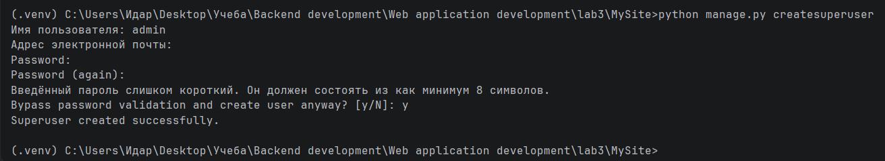
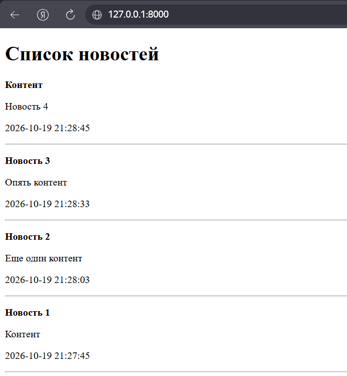
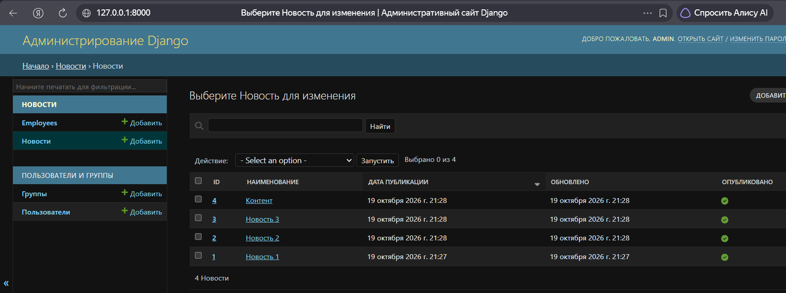
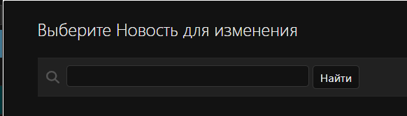
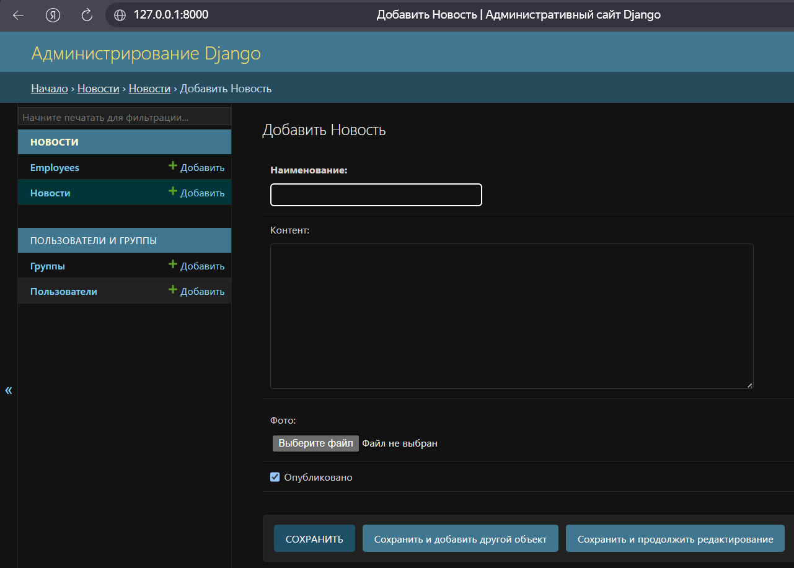
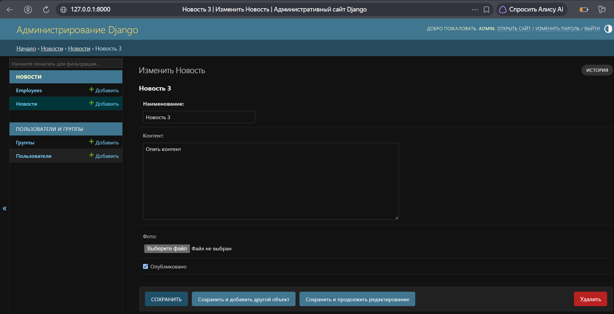

# Лабораторная работа №3. Шаблоны. Админка Django

**Студент:** Гуртуев Идар Алиевич

**Группа:** ПИЖ-б-о-25-1

**Технология:** Python + Django

**Репозиторий:** https://github.com/idarr1/Backend-development

---

## 1. Цель работы

Изучить работу с шаблонами (templates) в Django, освоить рендеринг данных из моделей в HTML-страницы, а также изучить настройку и работу административной панели Django.

---

## 2. Теоретическое обоснование

**Шаблон (Template)** — это HTML-файл с элементами шаблонизатора Django. Шаблоны используются для отделения логики от представления (HTML). По умолчанию Django ищет шаблоны в папке `templates` внутри приложений.

**Рендеринг** — процесс наполнения шаблона данными из модели и формирования готовой HTML-страницы. Для этого используется функция `render()` из модуля `django.shortcuts`.

**Контекст** — словарь с данными, которые передаются в шаблон. Ключи словаря становятся переменными, доступными в шаблоне.

**Шаблонизатор Django** работает с тремя объектами:
- **Директивы** (`{{ }}`) — выводят значения переменных;
- **Теги** (``) — управляют логикой (циклы `for`, условия `if`);
- **Фильтры** (`|`) — преобразуют данные перед выводом (например, `date:"Y-m-d H:i:s"`).

**Админка Django** — встроенная панель управления моделями. Регистрируется в файле `admin.py` через `admin.site.register()`. Настройки отображения задаются через класс `ModelAdmin`.

---

## 3. Выполнение практического примера

### 3.1. Создание шаблонов

В приложении `news` создана структура папок: `templates/news/index.html`. Это стандартный путь по рекомендации Django.

### 3.2. Настройка `settings.py`

Изменён язык на русский: `LANGUAGE_CODE = 'ru'`.
Добавлены настройки медиафайлов:
```python
MEDIA_URL = '/media/'
MEDIA_ROOT = BASE_DIR / 'media'
```

### 3.3. Переделка `views.py`

Контроллер `index` теперь использует `render()` и передаёт контекст:

```python
def index(request):
    news = News.objects.order_by('-created_at')
    context = {
        'news': news,
        'title': 'Список новостей'
    }
    return render(request, 'news/index.html', context)
```

### 3.4. Миграции

Внесены изменения в модель `News` (русские названия, `blank=True` для фото, сортировка). Созданы и применены миграции.

**Рисунок 1 — Выполнение миграций**



### 3.5. Создание суперпользователя

Выполнена команда `python manage.py createsuperuser`.

**Рисунок 2 — Создание суперпользователя**



---

## 4. Проверка работы

### 4.1. Вывод данных через шаблон

На странице `/news/` отображается список новостей с названиями, контентом и датами.

**Рисунок 3 — Список новостей через шаблон**



### 4.2. Админка Django

В админке зарегистрированы модели `News` и `Employee`. Отображаются русские названия, настроены колонки и поиск.

**Рисунок 4 — Список новостей в админке**



**Рисунок 5 — Поиск в админке**



**Рисунок 6 — Форма добавления новости**



**Рисунок 7 — Форма редактирования новости**



---

## 5. Итоговая структура проекта

```text
lab3/
├── .venv/
├── MySite/
│   ├── MySite/
│   ├── news/
│   │   ├── migrations/
│   │   ├── templates/
│   │   │   └── news/
│   │   │       └── index.html
│   │   ├── admin.py
│   │   ├── apps.py
│   │   ├── models.py
│   │   └── views.py
│   ├── media/
│   ├── db.sqlite3
│   └── manage.py
├── screenshots/
│   ├── 01-migrations.png
│   ├── 02-createsuperuser.png
│   ├── 03-news-list.png
│   ├── 04-admin-news.png
│   ├── 05-admin-search.png
│   ├── 06-admin-add.png
│   └── 07-admin-edit.png
├── .gitignore
└── README.md
```

---

## 6. Ответы на контрольные вопросы

### 1. Где Django по умолчанию ищет шаблоны?

В папке `templates` внутри каждого приложения. Рекомендуется создавать вложенную папку с именем приложения (`templates/news/`), чтобы избежать конфликтов имён.

### 2. Что такое рендеринг?

Процесс наполнения HTML-шаблона данными из контекста и формирования готовой страницы для отправки клиенту. Осуществляется функцией `render()`.

### 3. Что такое контекст в Django?

Это словарь, который передаётся в шаблон. Ключи словаря становятся переменными, доступными в HTML через `{{ }}`.

### 4. Чем отличаются `{{ }}` и `` в шаблонах?

- `{{ }}` — вывод переменных (директивы);
- `` — теги для логики (циклы, условия, наследование).

### 5. Для чего используется фильтр `date`?

Для форматирования даты и времени в нужном виде. Пример: `{{ item.created_at|date:"Y-m-d H:i:s" }}` выведет `2026-10-20 14:30:00`.

### 6. Как зарегистрировать модель в админке?

В файле `admin.py`: `admin.site.register(News)`. Для настройки отображения используется класс `ModelAdmin`.

### 7. Что делает атрибут `list_display`?

Задаёт список полей, которые будут отображаться в таблице списка объектов в админке.

### 8. Что делает атрибут `search_fields`?

Добавляет поле поиска в админке и указывает, по каким полям искать.

### 9. Что такое `verbose_name` в модели?

Человекочитаемое название поля (или модели), которое отображается в админке и формах. Например, `verbose_name='Наименование'`.

### 10. Для чего нужен класс `Meta` в модели?

Для задания метаданных модели: `verbose_name` (название в ед. числе), `verbose_name_plural` (во мн. числе), `ordering` (сортировка по умолчанию).

---

## 7. Вывод

В ходе лабораторной работы были изучены шаблоны Django и админка. Настроен вывод данных из модели `News` в HTML-шаблон через функцию `render()`. Освоены директивы `{{ }}`, теги ``, фильтр `date`. Изменён язык приложения на русский.

Настроена админка: зарегистрированы модели `News` и `Employee`, добавлены русские названия, настроены колонки (`list_display`), ссылки (`list_display_links`) и поиск (`search_fields`). Создан суперпользователь, добавлены новости через админку.

В результате получены практические навыки работы с шаблонизатором Django, рендерингом и административной панелью.

---

## 8. Список использованных источников

1. Django — Templates: https://docs.djangoproject.com/en/stable/topics/templates/
2. Django — Admin site: https://docs.djangoproject.com/en/stable/ref/contrib/admin/
3. Django — Model Meta options: https://docs.djangoproject.com/en/stable/ref/models/options/
4. Django — Built-in template tags and filters: https://docs.djangoproject.com/en/stable/ref/templates/builtins/