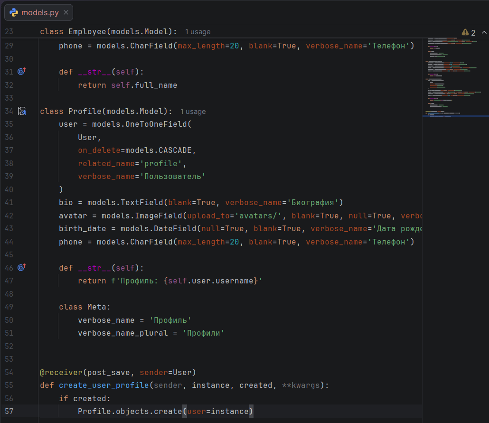
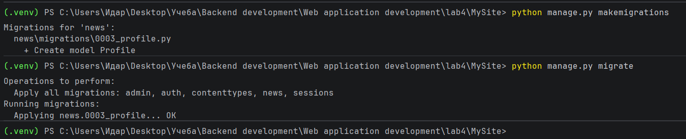
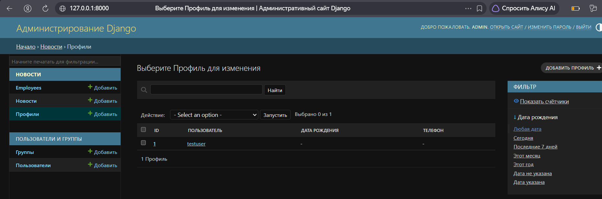
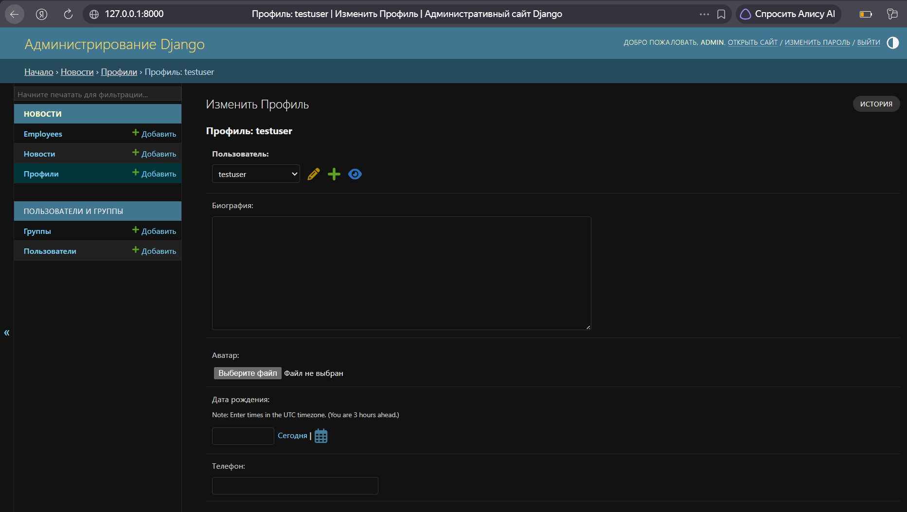
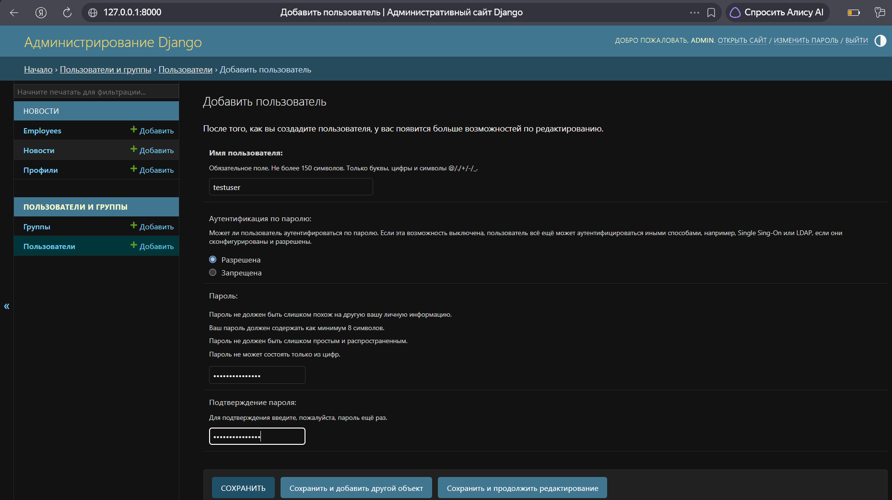
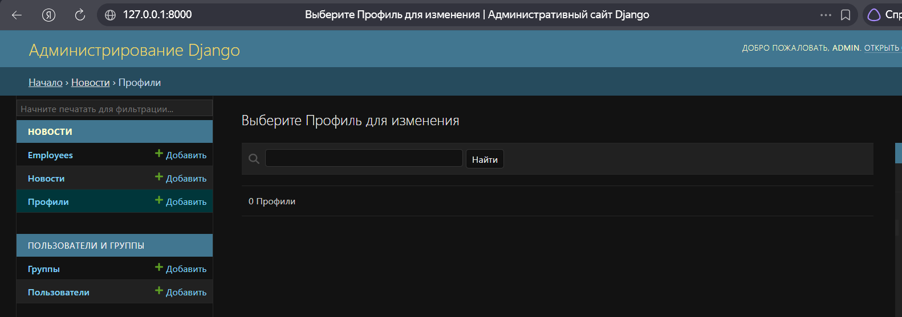

# Лабораторная работа №4. Связи между моделями Django

**Студент:** Гуртуев Идар Алиевич

**Группа:** ПИЖ-б-о-25-1

**Вариант:** 7 (Социальная сеть: пользователи и профили)

**Технология:** Python + Django

**Репозиторий:** https://github.com/idarr1/Backend-development

---

## 1. Цель работы

Освоить создание и настройку связей между моделями Django (ForeignKey, ManyToManyField, OneToOneField), изучить параметры связей (on_delete, related_name, null, blank, default), научиться применять миграции при добавлении связей к существующим моделям, а также настраивать отображение связанных данных в административной панели.

---

## 2. Теоретическое обоснование

**Связи между моделями** позволяют избежать дублирования данных и обеспечить их целостность. В Django есть три типа связей:

1. **ForeignKey** (многие-к-одному) — одна запись связана с несколькими записями другой модели. Например, одна категория — много новостей.
2. **ManyToManyField** (многие-ко-многим) — много записей связаны с многими. Например, один пост — много тегов, один тег — много постов.
3. **OneToOneField** (один-к-одному) — уникальная связь. Например, один пользователь — один профиль.

**Параметры связей:**
- `on_delete` — поведение при удалении связанного объекта (CASCADE, PROTECT, RESTRICT, SET_NULL).
- `related_name` — имя для обратного доступа (например, `user.profile`).
- `null=True` — разрешает NULL в БД.
- `blank=True` — разрешает пустое значение в формах.
- `default` — значение по умолчанию.

**Сигналы (`post_save`)** — позволяют автоматически выполнять код после сохранения объекта (например, создание профиля при создании пользователя).

---

## 3. Выполнение индивидуального задания (Вариант 7)

### 3.1. Модель `Profile`

Создана вторичная модель `Profile`, связанная с `User` через `OneToOneField`.

```python
class Profile(models.Model):
    user = models.OneToOneField(
        User,
        on_delete=models.CASCADE,
        related_name='profile',
        verbose_name='Пользователь'
    )
    bio = models.TextField(blank=True, verbose_name='Биография')
    avatar = models.ImageField(upload_to='avatars/', blank=True, null=True, verbose_name='Аватар')
    birth_date = models.DateField(null=True, blank=True, verbose_name='Дата рождения')
    phone = models.CharField(max_length=20, blank=True, verbose_name='Телефон')

    def __str__(self):
        return f'Профиль: {self.user.username}'

    class Meta:
        verbose_name = 'Профиль'
        verbose_name_plural = 'Профили'
```

**Рисунок 1 — Модель `Profile` и сигнал `post_save`**



**Параметры связи:**
- `OneToOneField` — один пользователь = один профиль.
- `on_delete=models.CASCADE` — при удалении пользователя профиль удаляется.
- `related_name='profile'` — доступ через `user.profile`.

### 3.2. Автоматическое создание профиля (сигнал)

При создании пользователя профиль создаётся автоматически через сигнал `post_save`.

```python
@receiver(post_save, sender=User)
def create_user_profile(sender, instance, created, **kwargs):
    if created:
        Profile.objects.create(user=instance)
```

### 3.3. Миграции

```bash
python manage.py makemigrations
python manage.py migrate
```

**Рисунок 2 — Применение миграций**



### 3.4. Настройка админки

В `admin.py` зарегистрирована модель `Profile`:

```python
@admin.register(Profile)
class ProfileAdmin(admin.ModelAdmin):
    list_display = ('id', 'user', 'birth_date', 'phone')
    list_display_links = ('id', 'user')
    search_fields = ('user__username', 'phone')
    list_filter = ('birth_date',)
```

---

## 4. Проверка работы

### 4.1. Список профилей

В админке отображается список профилей с фильтром по дате рождения.

**Рисунок 3 — Список профилей в админке**



### 4.2. Форма редактирования

При редактировании профиля доступны поля: биография, аватар, дата рождения, телефон.

**Рисунок 4 — Форма редактирования профиля**



### 4.3. Создание пользователя

Создание нового пользователя через стандартную админку Django.

**Рисунок 5 — Создание пользователя `testuser`**



### 4.4. Проверка `CASCADE`

После удаления пользователя `testuser` его профиль также удалился.

**Рисунок 6 — Список профилей после удаления пользователя**



---

## 5. Итоговая структура проекта

```text
lab4/
├── .venv/
├── MySite/
│   ├── MySite/
│   ├── news/
│   │   ├── migrations/
│   │   │   ├── 0001_initial.py
│   │   │   ├── ...
│   │   │   └── 0003_profile.py
│   │   ├── admin.py
│   │   ├── models.py
│   │   └── ...
│   ├── media/
│   ├── db.sqlite3
│   └── manage.py
├── screenshots/
│   ├── 01-models.png
│   ├── 02-migrations.png
│   ├── 03-admin-profile-list.png
│   ├── 04-admin-profile-edit.png
│   ├── 05-admin-user-add.png
│   └── 06-cascade-delete.png
├── .gitignore
└── README.md
```

---

## 6. Вывод

В ходе лабораторной работы изучены связи между моделями Django. Реализована связь `OneToOneField` между стандартной моделью `User` и моделью `Profile`. Настроены параметры связи (`on_delete=CASCADE`, `related_name`, `blank`, `null`).

Реализован сигнал `post_save` для автоматического создания профиля при регистрации пользователя. Настроена админка: зарегистрирована модель `Profile`, добавлены фильтры и поиск. Проверена работа каскадного удаления.

---

## 7. Список использованных источников

1. Django — Model field reference: https://docs.djangoproject.com/en/stable/ref/models/fields/
2. Django — Signals: https://docs.djangoproject.com/en/stable/topics/signals/
3. Django — Admin site: https://docs.djangoproject.com/en/stable/ref/contrib/admin/