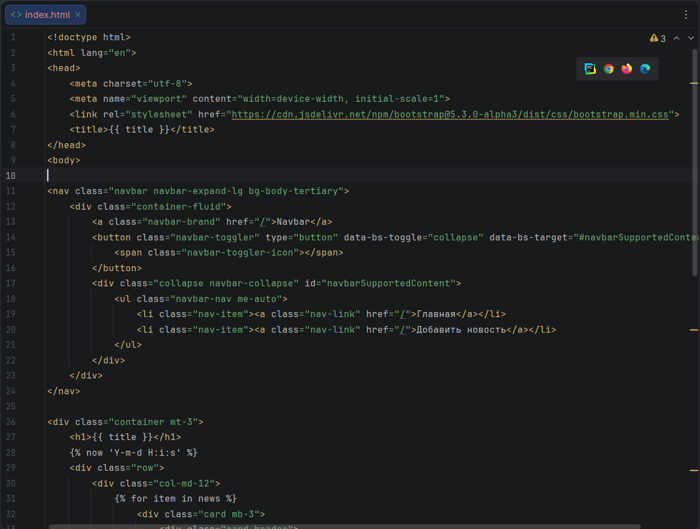
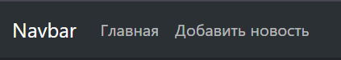
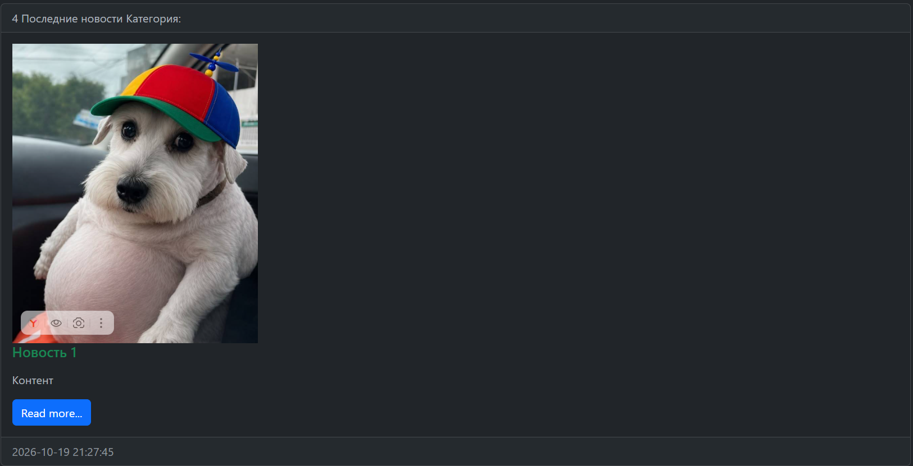
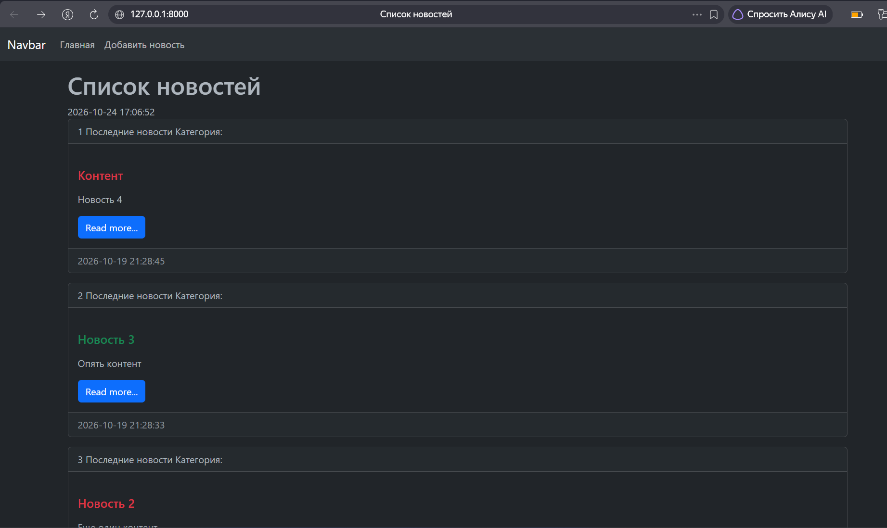

# Лабораторная работа №5. Bootstrap и расширенные возможности шаблонов Django

**Студент:** Гуртуев Идар Алиевич

**Группа:** ПИЖ-б-о-25-1

**Технология:** Python + Django

**Репозиторий:** https://github.com/idarr1/Backend-development

---

## 1. Цель работы

Освоить подключение CSS-фреймворка Bootstrap через CDN, научиться применять его компоненты (Navbar, Card, Container) для оформления страниц. Изучить дополнительные теги и фильтры шаблонизатора Django (``, ``, `{{ forloop.counter }}`, `truncatewords`, `safe`, `linebreaks`).

---

## 2. Теоретическое обоснование

**Bootstrap** — открытый HTML/CSS/JS фреймворк для быстрой вёрстки адаптивных сайтов. Подключается через CDN (Content Delivery Network) — сеть серверов для быстрой доставки контента.

**Компоненты Bootstrap:**
- `Navbar` — панель навигации.
- `Container` — контейнер для центрирования контента.
- `Card` — карточка для вывода структурированной информации.
- `Row` / `Col` — сетка для адаптивной вёрстки.

**Дополнительные теги Django:**
- `` — вывод текущей даты и времени.
- `` — чередование значений в цикле.
- `{{ forloop.counter }}` — номер итерации (1, 2, 3...).

**Фильтры:**
- `date:"Y-m-d H:i:s"` — форматирование даты.
- `truncatewords:50` — обрезка текста до 50 слов.
- `linebreaks` — замена переносов строк на HTML-теги `<br>`.
- `safe` — отключение экранирования HTML.

---

## 3. Выполнение работы

### 3.1. Подключение Bootstrap

В `index.html` подключён Bootstrap через CDN:

```html
<link rel="stylesheet" href="https://cdn.jsdelivr.net/npm/bootstrap@5.3.0-alpha3/dist/css/bootstrap.min.css">
```

**Рисунок 1 — Подключение Bootstrap в `index.html`**



### 3.2. Навигационная панель (Navbar)

Добавлена навигационная панель с ссылками «Главная» и «Добавить новость».

**Рисунок 2 — Навигационная панель**



### 3.3. Карточки новостей

Каждая новость выводится в компоненте `Card`. Внутри карточки реализовано:
- Нумерация (`{{ forloop.counter }}`)
- Вывод метода `my_func` («Последние новости»)
- Категория (`{{ item.category }}`)
- Цветной заголовок (``)
- Обрезанный контент (`{{ item.content|safe|linebreaks|truncatewords:50 }}`)
- Кнопка «Read more...»
- Дата создания (`{{ item.created_at|date:"Y-m-d H:i:s" }}`)

**Рисунок 3 — Карточка новости**



### 3.4. Общий вид страницы

На странице отображается текущее время (``), чередование цветов заголовков, адаптивная сетка Bootstrap.

**Рисунок 4 — Общий вид страницы `/news/`**



---

## 4. Итоговая структура проекта

```text
lab5/
├── .venv/
├── MySite/
│   ├── MySite/
│   ├── news/
│   │   ├── models.py
│   │   ├── templates/
│   │   │   └── news/
│   │   │       └── index.html
│   │   └── ...
│   ├── media/
│   ├── db.sqlite3
│   └── manage.py
├── screenshots/
│   ├── 01-bootstrap-code.png
│   ├── 02-navbar.png
│   ├── 03-card.png
│   └── 04-full-page.png
├── .gitignore
└── README.md
```

---
## 5. Вывод

В ходе лабораторной работы освоено подключение Bootstrap через CDN и применение его компонентов (Navbar, Card, Container, Row) для оформления страницы `/news/`.

Изучены дополнительные теги шаблонизатора Django: `` для вывода текущего времени, `` для чередования стилей, `{{ forloop.counter }}` для нумерации. Освоены фильтры `date`, `truncatewords`, `safe`, `linebreaks`.

Реализован вывод изображений с проверкой наличия (``) и заглушкой. Добавлен метод `my_func` в модель `News` и выведен в шаблоне.

В результате страница новостной ленты приобрела современный адаптивный вид с карточками, навигацией и корректным выводом данных. Применена тёмная тема через атрибут `data-bs-theme="dark"`.

---

## 6. Список использованных источников

1. Bootstrap — Getting started: https://getbootstrap.com/docs/5.3/getting-started/introduction/
2. Bootstrap — Components: https://getbootstrap.com/docs/5.3/components/
3. Django — Built-in template tags and filters: https://docs.djangoproject.com/en/stable/ref/templates/builtins/
4. Django — Templates: https://docs.djangoproject.com/en/stable/topics/templates/